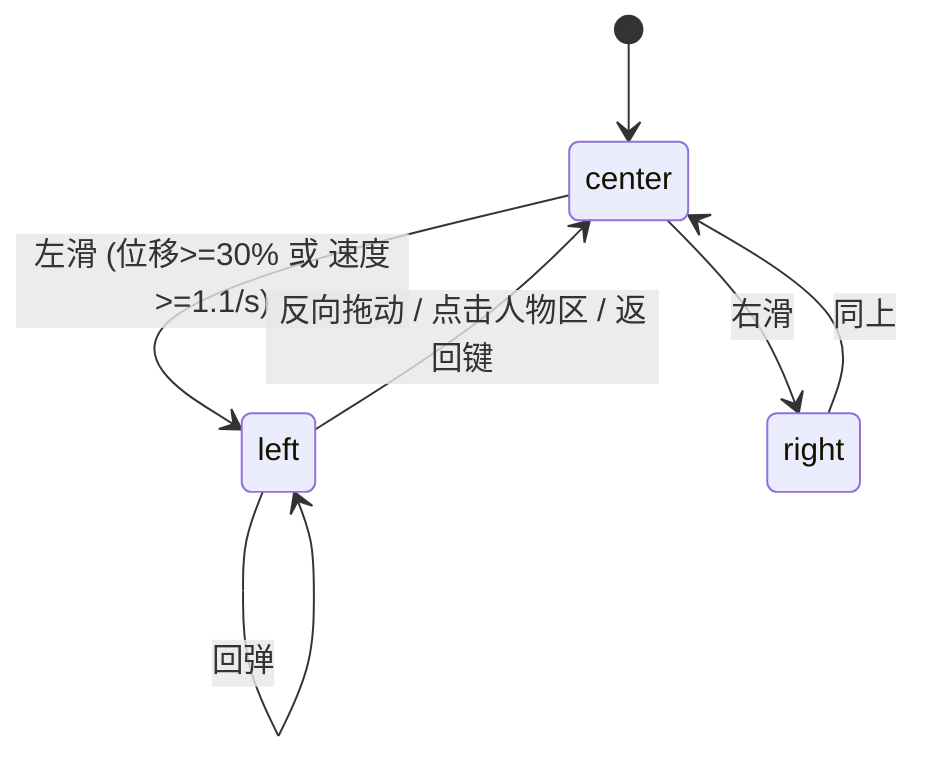

# Android 手势布局与取景

> 类型: feature
> 状态: active
> 负责人: sonnet-ws5
> 更新: 2026-10-12
> 关联: apps/android/app/src/main/assets/web/js/layout.js, js/app.js, test/android-web/layout.test.js, TC-AWB-003, TC-AWB-004, TC-AWB-009..TC-AWB-011

## 1. 概述

竖屏全身 + 背景；横屏默认居中聚焦上半身。横屏时左滑 → 人物左移、右侧出现"插件"入口网格；右滑 → 人物右移、左侧出现"桌面组件"。手指实时拖动，松手按位移/速度吸附到 left / center / right，带回弹。启用桌面抽屉时上滑打开应用抽屉。

## 2. 行为说明

### 2.1 状态

面板进度 `p ∈ [-1, 1]`：`p=-1` 人物在左、插件面板在右；`p=0` 居中；`p=+1` 人物在右、桌面组件在左。吸附状态 `S.panelState ∈ {-1,0,1}`。

- 手势：`createGestureTracker`（slop 10 px，轴锁定比 1.15，90 ms 窗口测速）。横向锁定且横屏、无打开的 app/抽屉/编辑模式时进入面板拖动；纵向且启用抽屉时进入抽屉拖动。
- 跟手：`p = start + dx / panelW`，超界按橡皮筋阻尼（0.35）。人物移动 `p*panelW/2`（视差感），并轻微缩小（最多 5%）。
- 松手：`resolvePanelSnap({progress, velocity, from})`：`projected = progress + v*0.12s`；位移/投影超过 0.3 或速度 ≥ 1.1 进度/秒 → 前进一档（一次手势不会跨过中间态），否则回弹。弹簧继承手指速度（stiffness 260, damping 27，轻微过冲）。
- 面板宽度 `clamp(46% * viewW, 260, 560)`；面板透明度随进度渐显；只在 |p|>0.5 时可点击。
- 竖屏不启用面板（契约：横屏）。竖屏旋转为横屏时保留 `panelState=0`；横屏转竖屏时面板与已打开插件被收起。

### 2.2 取景（相机）

`computeFrame({viewW, viewH, content, focus})`：以模型真实外框 `content` 为基准；`focus=full` 取整框（上边距 4%、下边距 2.5%、左右 4%）；`focus=upper` 取外框上 55%，底边与屏幕底对齐（腰部出血）。`placeModel` 得到模型缩放与位置。

- 相机缩放/位置是三个弹簧（stiffness 110, damping 21，约 550–600 ms 近临界阻尼）；方向切换（视口尺寸变化）时只改目标，弹簧从当前值连续过渡 → 全身 ↔ 上半身聚焦动效，无跳变。
- 面板位移叠加在相机之上，绕外框底部中心缩放，二者独立插值。
- `resolveFocus`：竖屏 `portrait_full_body=false` 时用 upper；横屏 `landscape_focus=full_body` 时用 full，默认 upper。

### 2.3 应用抽屉（Launcher）

`launcher.enabled` 为真且无面板打开时，纵向上滑 → `drawer` 进度 `q ∈ [0,1]`（弹簧 300/31）。`resolveDrawerSnap` 按进度/速度吸附。内容为 `listLaunchableApps()` 网格 + 搜索；点击 `launchApp(package)`。抽屉打开时点击上方空白或返回键关闭；在顶部手柄/搜索框区域下拉关闭。

### 2.4 点击与长按

点击人物区（面板打开时）关闭面板；点击头部/身体触发互动；长按 520 ms（人物上）打开菜单；返回键优先级：菜单 → 插件 app → 组件编辑 → 抽屉 → 面板 → 不消费（原生默认行为）。

## 3. 接口与协议

纯函数模块 `layout.js`（UMD）：`createSpring`、`stepSpring`、`computeFrame`、`placeModel`、`panelGeometry`、`panelTransforms`、`rubberband`、`resolvePanelSnap`、`resolveDrawerSnap`、`createGestureTracker`、`resolveQuality`、`resolveFocus`。

## 4. 配置项

| 键 | 默认 | 说明 |
|---|---|---|
| `appearance.portrait_full_body` | true | 竖屏是否全身 |
| `appearance.landscape_focus` | upper_body | upper_body / full_body |
| `launcher.enabled` | false | 启用应用抽屉 |

## 5. 限制与已知问题

- 右侧"桌面组件"里的 iframe 会吞掉触摸事件，因此在组件卡片上无法直接拖动关闭面板；请在人物区或空白处滑动，或点击人物区/返回键。
- 组件排布编辑通过"编辑"按钮进入（组件 iframe 吞掉了长按），编辑态下卡片上有透明遮罩可拖动。
- 抽屉列表为 `touch-action: pan-y`，在列表内下拉不会关闭抽屉。

## 6. 测试用例

TC-AWB-003、TC-AWB-004、TC-AWB-009、TC-AWB-010、TC-AWB-011（`docs/testing/TC-android-web.md`）；自动化 `test/android-web/layout.test.js`。
