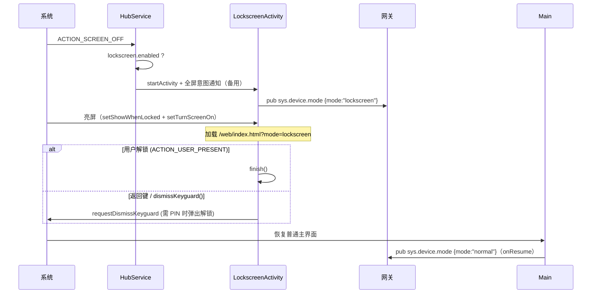

# Android 桌面接管（Launcher）与锁屏显示人物

> 类型: feature
> 状态: active
> 负责人: sonnet-ws4
> 更新: 2026-10-12
> 关联: docs/features/FEAT-android-native-shell.md, docs/plans/PLAN-android-ws4-android-native.md, TC-AND-029…TC-AND-034

## 1. 概述

- **Launcher**：Yachiyo 可被用户设为系统默认桌面；作为桌面时返回键不会退出，Web 层可通过 Bridge 获取应用列表与图标并启动应用（应用抽屉）。
- **锁屏人物**：开启后，每次息屏时原生预先启动 `LockscreenActivity`（显示在锁屏之上），亮屏即看到人物；agent 仍可控制人物、语音与麦克风，但**插件完全不可用**。

## 2. 行为说明

### 2.1 Launcher

- `MainActivity` 带 `MAIN + HOME + DEFAULT` intent-filter，因此出现在系统"默认桌面应用"选择中。系统默认桌面始终由用户在系统设置选择：Bridge `openHomeSettings()` 跳转 `Settings.ACTION_HOME_SETTINGS`（失败回退到系统设置首页）。`launcher.enabled` 配置**只**影响 Web UI 行为。
- 是否为默认桌面：`RoleManager.isRoleHeld(ROLE_HOME)`（API 29+，`getDeviceInfo().is_default_launcher`）。（早期用 `resolveActivity(HOME)` 在多个桌面共存时会误报，已弃用。）
- 为默认桌面时：返回键只向 Web 发 `back`，300 ms 内无人消费也不离开；按 Home 键（`onNewIntent` 带 HOME 类别）时发 `lifecycle{state:"resume"}`，让 Web 复位（关抽屉等）。
- `listLaunchableApps()` 返回 `[{package, label, icon_url}]`（`MAIN/LAUNCHER`，排除自身，按名称排序，需 manifest `<queries>`）；`launchApp(package)` 以 `NEW_TASK` 启动。`icon_url` 由 `WebViewAssetLoader` 的 `/appicon/` 处理器提供：校验包名、渲染 144 px PNG（自适应图标会先画到位图）、LRU 缓存，响应带 `Cache-Control: max-age=3600`。

### 2.2 锁屏

- Activity：`singleInstance`、`taskAffinity=""`、`excludeFromRecents`、`showWhenLocked`、`turnScreenOn`、保持屏幕常亮标志；`HubClient.currentMode` 同步进入重连时的 `hello.mode`。
- 解锁/返回会请求系统关闭 keyguard 并结束人物覆盖页；ROM 不回调时 750 ms 后只关闭覆盖页，系统认证界面仍保留，不绕过设备解锁。
- 屏幕开/关与解锁通过 `lifecycle {state: screen_off|screen_on}` 通知 Web（所有 Activity 动态注册广播）。
- **插件隔离**：资源层 `/plugins/*` 返回 403；Bridge 层：`hubSubscribe/hubPublish/hubRpc/hubRegister` 过滤或拒绝 `plugin.*`，入站 `plugin.*` 事件不转发给 Web、入站 `plugin.*` RPC 回 `-32006`；`listPlugins()=[]`、`pluginStorage*` 无效、`pickPluginPackage`/`uninstallPlugin`/`setPluginEnabled` 拒绝、`plugin.install` 推送回 `plugin.install_failed`；`openSettings`/`launchApp`/`listLaunchableApps` 禁用。网关侧同样会对 `mode=lockscreen` 设备返回 `-32006`（契约 C1.4）。
- **单一活动宿主**：进入锁屏时把 `HubClient.currentMode` 切为 `lockscreen`，普通 Main WebView 随即停止接收入站事件/RPC；任何人物 Activity 恢复前台时都会用自身 mode 抢回 Hub 路由并重放最新状态。这样即使 ROM 只暂停而不销毁锁屏 Activity，回到 Main 也会恢复 `normal`，同一条动作或语音只进入一个页面。
- 麦克风/音频/avatar 功能正常。

## 3. 接口与协议

Bridge：`openHomeSettings()`、`listLaunchableApps()`、`launchApp(pkg)`、`setLockscreenEnabled(bool)`、`dismissKeyguard()`（扩展）、`getDeviceInfo().is_default_launcher/mode`。Hub：`pub sys.device.mode {mode}`。Web 加载 URL：`https://appassets.androidplatform.net/web/index.html?mode=lockscreen`。

## 4. 配置项

| 键 | 默认 | 说明 |
|---|---|---|
| `launcher.enabled` | `false` | Web UI 是否启用桌面形态 |
| `lockscreen.enabled` | `false` | 息屏时预启动锁屏人物；`setLockscreenEnabled(true)` 同时确保前台服务在运行 |

## 5. 限制与已知问题

- 息屏时从后台启动 Activity 受 Android 10+ 后台启动限制：实现同时尝试直接 `startActivity` 与全屏意图通知（`USE_FULL_SCREEN_INTENT`）。在 MI 6 / Android 15 上验证有效（通知被 `LockscreenActivity` 启动时取消）；其他 ROM 可能需要用户授予"全屏通知"或"悬浮窗"权限。
- 全屏意图通知会在个别情况下短暂弹出 heads-up 横幅。
- 锁屏模式要求 `HubService` 在运行（App 至少被打开过一次且未被系统杀掉）。
- 安全锁屏（PIN/指纹）下，人物显示在锁屏之上但不会绕过解锁：返回键触发系统解锁界面。
- 不支持开机自启。

## 6. 测试用例

TC-AND-029（设为默认桌面）、TC-AND-030（应用列表与图标）、TC-AND-031（锁屏显示）、TC-AND-032（锁屏插件隔离）、TC-AND-034（解锁与返回）、TC-AND-050/051（多宿主路由）、TC-AND-054（前台宿主恢复与状态重放），单元：TC-AND-035（包名/图标路径校验）。见 `docs/testing/TC-android-native.md`。
