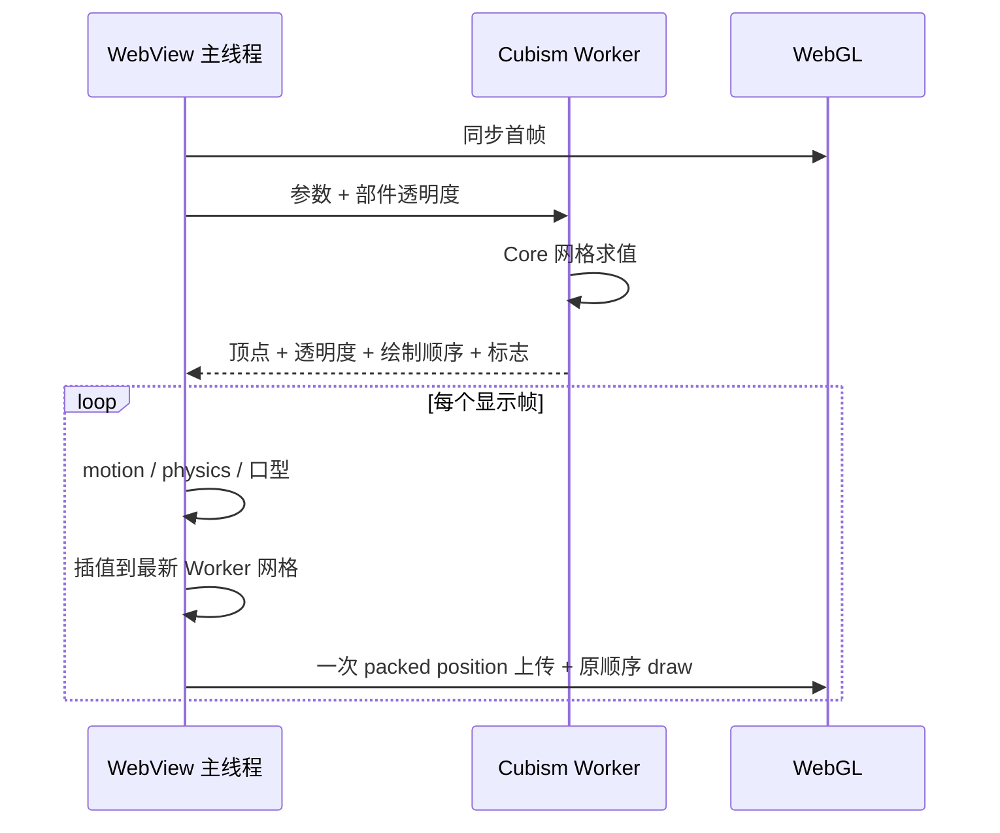

# Android Live2D 性能管线

> 类型: feature
> 状态: active
> 负责人: codex-pi-completion
> 更新: 2026-10-13
> 关联: apps/android/app/src/main/assets/web/js/stage.js, apps/android/app/src/main/assets/web/js/live2dCoreBridge.js, apps/android/app/src/main/assets/web/js/live2dCoreWorker.js, apps/android/app/src/main/assets/web/js/live2dRendererOptimizer.js, scripts/android-profile-live2d.js, docs/experiments/EXP-20261012-android-live2d-performance.md, docs/testing/TC-android-web.md

## 1. 概述

Android WebView 把 Cubism Core 网格求值移到专用 Worker，并在真实逐帧 WebGL 绘制前插值 Worker 网格、复用打包 GPU buffer。用户能看到连续的人物形变、口型和物理摆动，同时滑动与相机动画按显示帧更新。

## 2. 行为说明

加载模型后，主线程先走同步 Cubism 路径生成首帧。Worker 加载同一份 Core 与 moc，接收当前参数和部件透明度，异步计算下一份 drawable 状态。第一份 Worker 结果只用于完成预热并回收 buffer，主线程继续同步求值；第二份结果到达时从屏幕当前网格开始平滑接管，不在消息回调中改动画面。相邻 Worker 网格按实际到达间隔在每个显示帧线性插值，透明度同步插值，并持续标记顶点变化以刷新 clipping mask；离散的 render order 在对应网格插值越过 50% 时切换，若更快的新结果提前到达则先提交上一代 order，避免层级长期冻结。motion、表情、口型、呼吸、physics、pose、相机和 WebGL draw 都仍在每个显示帧执行。

渲染优化保留 drawable 原有 painter order、texture、blend、cull、clip 与 inverted-mask 语义。全部顶点、UV 和 index 分别使用一个 packed buffer；UV/index 只初始化一次，position 每个显示帧一次 `bufferSubData`。每个模型 draw pass 还记录当前 program、buffer、texture、blend、cull、front-face、attribute 与 uniform，仅省略该 pass 内值完全相同的后续 WebGL 状态调用；下一 pass 从未知状态重新建立缓存。若 Worker 启动、消息形状或运行时发生错误，stage 立即回退到同步 Core。启动超过 12 秒或单帧超过 3 秒没有响应也会终止 Worker 并回退；页面进入后台时暂停计时，恢复可见后重新开始完整截止期。若 GL 方法不能安全安装优化包装，则 renderer 使用原始路径。

## 3. 接口与协议

`live2dCoreBridge.js` 创建 `/web/js/live2dCoreWorker.js`。内部消息只在同一 WebView 中使用：

- `init`: `coreUrl`、`modelUrl`。
- `ready`: drawable 数量、顶点值数量。
- `update`: `Float32Array parameters`、`Float32Array parts`，以及可复用的上一组 drawable buffer。
- `frame`: 顶点、透明度、绘制顺序、动态标志、参数回收 buffer 和 Worker 耗时。
- `error` / `destroy` / `destroyed`: 回退、释放与确认。主线程还以可见页面时间约束启动和单帧响应。

参数、部件和 drawable typed array 通过 transferable buffer 循环复用。Worker 为 7 MiB 生产 moc 预留 64 MiB Core heap；销毁时释放 model 与 moc，主线程等待确认并有 250 ms terminate 兜底。

页面提供只读采样钩子 `window.__yachiyoPerf.begin()` / `snapshot()`。begin/snapshot 在页面内用同一个 `performance.now()` 时钟计算 `elapsedMs`，脚本以该值计算 rAF、draw 与 Worker 频率；主机墙钟只作为 CDP 排队诊断字段。`scripts/android-profile-live2d.js` 通过命令行显式传入的 CDP forward 端口读取它，不在产品中写死调试地址。

## 4. 配置项

无需新增用户配置。现有 `appearance.model_quality` 仍支持 `auto`、`2048`、`4096`：

| 条件 | 自动纹理 | renderer resolution 上限 |
|---|---:|---:|
| `low_ram=true` 或总内存不高于 6144 MiB | 2048 | 1.25 |
| 其他设备 | 4096 | 1.5 |
| 用户显式选择 2048/4096 | 尊重选择 | 仍按设备档位 |

physics 保持原库逐显示帧求值。不得直接跳过 physics 帧；Cubism 在每帧末尾用 `loadParameters()` 恢复 motion 基线，跳过会让模型在物理姿态与基线之间交替。

## 5. 限制与已知问题

- Worker 与主线程各保留一份 Core model/moc 状态，受限设备用 2048 纹理降低主要纹理内存。
- Worker 的 Core 求值频率低于显示刷新率；每个显示帧绘制的是相邻求值结果间的新插值网格，Worker 频率必须与 rAF/draw 频率分别报告。
- 当前 Core 是官方托管的 JavaScript 构建，文件内禁用原生 WebAssembly；官方 Web SDK 未提供可直接替换的独立 wasm 文件。
- 60 FPS 是小米 6 横屏真机验收目标。最终数字与失败试验均记录在实验文档，不以冻结人物、仅移动整张 canvas 或隐藏 draw 计数。

## 6. 测试用例

- `TC-AWB-025`：小米 6 真机 rAF、真实 draw、Worker 求值和连续动作验收。
- `TC-AWB-027`：Worker 桥接、逐帧网格/透明度插值、mask dirty 与 buffer 循环复用。
- `TC-AWB-028`：Worker Core 初始化、求值、64 MiB heap 和资源释放。
- `TC-AWB-029`：packed buffer offset、原顺序 draw、透明裁剪、异常和资源释放。
- `TC-AWB-030`：异步模型加载跨越 stage 重建时的 generation 隔离与资源释放。
- 自动化：`test/android-web/layout.test.js`、`test/android-web/live2dPerformance.test.js`、`test/android-web/live2dRendererOptimizer.test.js`、`test/android-web/stageLifecycle.test.js`、`test/scripts/androidProfileLive2d.test.js`。
