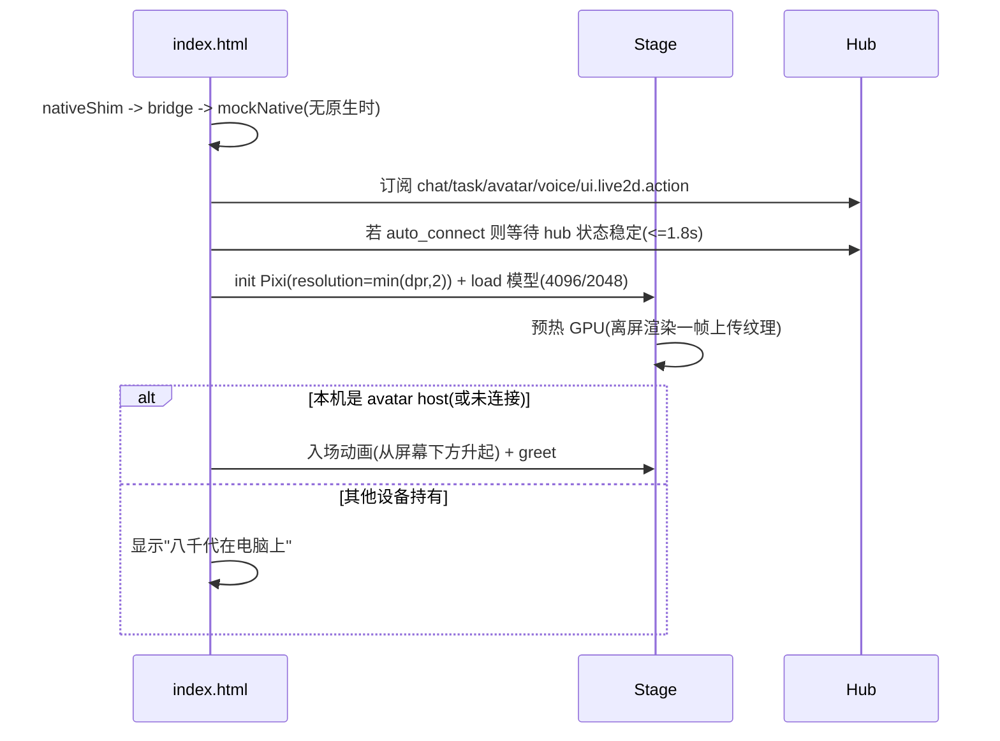

# Android Live2D 舞台（WebView）

> 类型: feature
> 状态: active
> 负责人: sonnet-ws5, Codex（工作流 A / T）
> 更新: 2026-10-13
> 关联: docs/plans/PLAN-android-ws5-web-ui.md, docs/experiments/EXP-20261012-android-live2d-webview-feasibility.md, docs/experiments/EXP-20261013-android-mouth-neutral.md, docs/experiments/EXP-20261013-live2d-body-twitch.md, scripts/android-sync-assets.js, apps/android/app/src/main/assets/web/, test/android-web/, TC-AWB-001..TC-AWB-048

## 1. 概述

Android WebView 内用 pixi.js@6 + pixi-live2d-display(cubism4) 渲染八千代，复用桌面端的动作消息/互斥/队列/执行器与口型模块。用户看到：竖屏全身、可自定义背景、点头/点身体有反应、能说话（口型同步）、能被电脑端 agent 驱动、能在电脑与手机间移交。

## 2. 行为说明

### 2.1 资源同步

`npm run android:sync-assets` 生成 `apps/android/app/src/main/assets/generated/`（gitignore，契约 C6）：

- `lib/`：pixi.min.js、cubism4.min.js、live2dcubismcore.min.js（下载并缓存到 `~/.cache/yachiyo/`）。
- `shared/`：桌面端共享模块副本（动作消息/互斥/队列/执行器、口型 viseme/过渡、实时语音播放器）。
- `model/4096/`、`model/2048/`：降采样模型（macOS 用 `sips`，否则 `magick`/`convert`，都没有则复制原图并警告）；文件重命名为 ASCII，`model3.json` 纹理路径已修正。
- `config/live2d-presets.json`：由 `config/live2d-presets.yaml` 转换（emote/gesture/react 预设）。
- `manifest.json`：模型各档位入口、库与模块清单。

`--serve` / `--serve-only [--port 8790]` 以 assets 目录为根提供静态服务，映射 `/sdk/`、`/plugins/<id>/`（示例插件）与 `/__dev/plugins`（mockNative 用）。

### 2.2 启动与舞台

- 质量档：`appearance.model_quality`（auto/4096/2048）；auto 时 `getDeviceInfo().low_ram` 或总内存 < 3000 MB → 2048，否则 4096。
- 单一帧循环：Pixi 自带 ticker 被关闭（`autoStart:false`，`autoUpdate:false`），由 `app.js` 的 rAF 统一推进弹簧、DOM 变换、口型与渲染，避免多源时序抖动。
- 取景（见 FEAT-android-gesture-layout）由弹簧驱动；模型真实外框由可见 drawable 的包围盒并集得到，而不是画布留白。
- 性能策略：Cubism Core 的网格更新在小米 6 上约 21 ms/帧（CPU）。交互动画期间（拖动、取景、移交）仅每 ~90 ms 做一次完整模型更新，其余帧只用新的变换重绘缓存网格；静止时每帧完整更新。恢复完整更新时只推进当前页面帧的 dt，丢弃 cached-model 帧期间冻结的模型时间，且单步沿用页面既有的 50 ms 上限，避免身体物理追帧瞬移。本修复不以提高 FPS 为目标。
- `webglcontextlost` / 恢复：丢失后销毁并重建 Pixi 应用与模型（`rebuildStage`），可见状态与相机保持；回前台（`lifecycle resume` / `visibilitychange`）也会检查 `gl.isContextLost()`。`pause`/`screen_off` 停止帧循环并终止当前语音，避免普通页面与锁屏页面同时播放。
- 点击互动：头部（外框上 27%）→ `smile` 表情 + 轻振动；身体 → `Greet` 动作；长按人物 → 菜单（去电脑那边 / 设置 / 打招呼）。指针移动时模型 `focus` 跟随视线。

### 2.3 动作与 RPC（契约 C1.4 / C1.6）

| 入口 | 处理 |
|---|---|
| `hub.rpc.request state.get` | 返回 `{modelLoaded, modelName, quality, visible, queue, avatar_host, is_host, landscape, panel}` |
| `model.motion.play` / `model.expression.set` | 经互斥锁调用 `model.motion/expression` |
| `model.param.set` / `model.param.batchSet` | 参数覆盖层：每帧在 `beforeModelUpdate` 中以权重 0→1 平滑混入当前动作（避免被 motion 覆盖）；`stage.releaseParams()` 平滑退出 |
| `live2d.action.enqueue` 与 `ui.live2d.action` 事件 | `Live2DActionMessage.normalizeLive2dActionMessage` → `Live2dActionQueuePlayer`（idle 回退为 Idle 动作 + 复位表情/参数） |

预设（emote/gesture/react）来自 `generated/config/live2d-presets.json`。错误码沿用桌面（-32602 / -32004 / -32005）。

调试时可经 CDP 调用 `window.__yachiyoStage.startTrace()` / `stopTrace()`，或临时在页面 URL 加 `trace=1`。trace 默认关闭，记录逐帧 raw/applied/physics dt、motion 组/索引/优先级、表情与 focus 事件、RPC/action overlay 来源，以及 motion 前后和最终的角度/身体/physics 关键参数。`scripts/dev/live2d-trace-capture.js` 负责采集，`live2d-trace-analyze.js` 输出每参数最大帧差和最坏点。

### 2.4 移交（契约 C1.5）

| 事件 | 本机行为 |
|---|---|
| `avatar.transfer.prepare {to=本机}` | 确保模型已加载+预热，置于屏幕下方（parked），回 `avatar.transfer.ready` |
| `avatar.transfer.exit` | 下蹲(y+2%,120 ms) → 沿下方滑出(480 ms, `cubic-bezier(.55,0,.75,.2)`)，回 `exited`，随后隐藏并显示"八千代在电脑上" |
| `avatar.transfer.enter` | 从下方升起(520 ms, `cubic-bezier(.2,.8,.2,1.1)` 带回弹)，播放 greet，回 `entered` |
| `avatar.transfer.cancel` | parked 则隐藏；已离场则重新入场恢复 |
| `avatar.host.changed` | 更新 host；非 host 隐藏人物、不播 TTS |

顶部 HUD 常驻迁移控件：本机持有角色时显示「叫回电脑」，非本机持有时显示「让她过来」；辅助文字同时显示 owner 和电脑在线状态。断线、owner 未知、电脑离线或迁移中时按钮禁用，不会重复发起 RPC。非 host 时仍保留居中提示卡与「叫她过来」快捷按钮。

设备上线/离线事件会立即合并到页面的 Hub 快照并重算迁移控件。桌面端在手机连接之后启动时，手机无需重连即可从「电脑离线」切换为「电脑在线」并启用「叫回电脑」；同一设备重复上线会覆盖旧条目，不会产生重复设备。

每次迁移以 `transfer_id` 和本地 generation 共同校验异步 `prepare/exit/enter`。`failed/cancel`会使旧 continuation 失效并解决被取消的动画 Promise，因此 cancel 之后不会误发 `avatar.transfer.entered`；`failed/completed/cancel/断线` 都会清理对应 pending。人物只在 owner 明确为本机时渲染；断线时保留最后一个权威 owner，不会自动把本机当成 host。动画时间线是纯函数（`js/transfer.js`），有单测。

### 2.5 音频与口型

- `voice.play {request_id,url}`：`fetch`（URL 自动补 `http://host:port` 与 `?token=`）→ `decodeAudioData` → AnalyserNode → 口型驱动；回执 `voice.playback.started/ended`。新的播放会打断旧的。Android 使用 `latencyHint:'playback'` 避开部分 ROM 无法启动的 AAudio 低延迟 MMAP 路径；旧 WebView 不接受该选项时回退到无参构造。
- `voice.stream.start/chunk/end/error`：复用桌面 `RealtimeVoicePlayer`（PCM s16le，24 kHz 默认，预缓冲 160 ms）。
- 口型：`js/lipsync.js` 把 AnalyserNode 频谱送入 `Live2DVisemeLipSync.resolveVisemeFrame`，经与桌面一致的增益/死区整形与 `Live2DMouthTransition` 平滑，写 `ParamMouthOpenY/ParamMouthForm`。无语音时，舞台在每次真实模型更新的 `beforeModelUpdate` 中恢复 MOC 声明的口型默认值，避免 Idle/Greet/Error motion 内恒定的 `ParamMouthForm=1` 留下持续怪嘴。优先级为 motion < 中性默认层 < action/RPC 参数 overlay < 活跃语音口型；中性层不会令显式口型动作失效。
- 小米 6 真机三状态验收（`ecdfb6b`）：静音 Idle 15 秒的 466 次真实更新全程 `OpenY/Form=0/0`；本地参考音频播放时 `OpenY` 覆盖 0–0.9976、`Form` 覆盖 -0.6899–0.0311，视觉自然；自然结束后连续 3 秒 94 次真实更新重新全为 0/0。完整方法见 `EXP-20261013-android-mouth-neutral.md`。
- 麦克风：按钮按住说话（< 280 ms 视为误触取消）或连续模式；`micStart/micStop`，电平 `mic.level` 驱动按钮光圈；`audio.input.transcript` 显示为用户气泡。
- 自动播放策略：首次触摸时解锁 AudioContext（原生 WebView 还需 WS4 关闭 `mediaPlaybackRequiresUserGesture`）。URL 和实时流播放都必须在 2 秒内进入 `running`，并在开始后 300 ms 内保持 running 且推进音频时钟；仍挂起、恢复超时或启动失败时清理当前播放并只发 ended，不误报 started。

### 2.6 对话面板（任务画布 / 聊天气泡）

订阅 `chat.delta`（按 `trace_id` 流式追加到对应助手气泡）、`chat.final`（按同一 trace 定稿且重复 final 幂等；完整消息约 10 秒后淡出，用户正在触摸/滚动时顺延）、`audio.input.transcript`（用户气泡）和 `task.update`。工具记录不再混入聊天画布，而是在右上角独立卡片队列展示标题、最近 4 个步骤和 running/done/failed 状态，完成/失败 8 秒后淡出。同一任务内名称与状态相同的重复步骤合并为一行并显示次数（如 `shell.exec ×3`）。每张气泡独立持有淡出计时器；新回答开始只更新自己的计时，不会取消旧回答。流式回答若 30 秒没有新增量且未收到 final，视为通道中断并自动淡出。文本输入框发送 `chat.input {text}`。

- **竖屏**：以模型 bounds 顶部向下 24% 的脖子线为上界，面板位于脖子线 + 10 px 到输入栏上方，可覆盖身体而不覆盖脸；左右各留 14 px。`task_canvas.position` 在竖屏只有 `hidden` 生效。
- **横屏**：居中态使用一块完整宽屏对话区，回答左对齐、用户消息右对齐并按时间顺序排列。全身取景以模型外框顶部向下 30% 为脸部保护线；默认上半身聚焦使用 20%。面板横向填满安全区，长文本气泡超过 180 字时扩展到安全区全宽并从底部向上占用可用高度，触顶后内部滚动；面板上沿始终位于脸部保护线下，因此只覆盖人物下半身。左右拖动时同一面板随弹簧连续收窄并移动到侧栏外。状态点、迁移控件、设置按钮、输入区、语音/聊天按钮、侧栏及插件面板均参与避让。
- **历史会话**：普通模式可从屏幕上方约 22% 的手势区下拉，不要求贴着状态栏开始；面板底边跟随手指，释放位置未过屏幕中线吸附半屏，过中线吸附全屏。输入框下方有全宽底边抓取区，从屏幕最底边或面板非滚动空白区上推时同样跟手，底边未推过中线吸附半屏，推过中线完全收起。聊天气泡、消息滚动区、输入框正文、发送按钮和工具卡区域不会触发该手势；半屏预览也可点击卡片外空白遮罩直接关闭。竖屏用紧凑的顶部横向会话栏，横屏改为左侧自上而下的会话栏与右侧历史区；横竖屏切换以淡出位移动画重排。面板底部输入框可直接向当前会话发消息；历史消息安全渲染 Markdown 标题、列表、引用、代码、表格和链接。新建或选择会话后，文字、麦克风、Realtime、审批策略和工具执行共享同一 Pi `AgentSession`；旧会话的迟到消息不会进入当前气泡区。锁屏模式不提供历史入口。
- **滚动**：回答列、用户列和合并视图各自拥有 `.chat-scroll`（`pointer-events:auto; touch-action:pan-y`），整个滚动区都在 `IGNORE` 选择器中，不会触发舞台滑动/抽屉。每列新内容默认自动滚到底；用户上滑离底超过 24 px 后只停止该列自动跟随。合并视图按事件发生顺序排列；保留最近 8 条气泡。
- **动效**：面板首次出现 `translateY(16px)→0` 240 ms；消息 `translateY(8px)→0` 140 ms；淡出 420 ms（见 `UI_DESIGN_SYSTEM.md` §6）。不透明度 `task_canvas.opacity`，下限 0.9 以保证可读。
- **软键盘**：主界面和锁屏 Activity 使用 `adjustNothing`。原生层以 `WindowInsetsCompat.Type.ime()` 读取高度（旧系统使用 visible-frame 差值兜底），通过 C2.2 `ime {visible,height_px,height_css}` 下发。Web 层只更新 `--ime` 并重算输入栏上方的面板端点；舞台 canvas、人物取景与面板弹簧坐标不变。键盘占用后可读高度不足 56 px 时，对话面板暂时隐藏，输入栏仍位于键盘上方。

### 2.7 锁屏模式（`?mode=lockscreen`）

仅人物 + 麦克风 + 语音 + 时钟 + 解锁按钮（点击或上滑 → `dismissKeyguard()`）；不创建插件宿主、不显示设置/聊天输入/面板/抽屉；取景下移避开时钟。

### 2.8 开发期 mockNative

无 `YachiyoNative` 时 `js/mockNative.js` 接管：配置存 localStorage、假应用列表、示例插件（`/__dev/plugins`）、可选浏览器 WebSocket 连接网关 `/ws/device`（`?hub=1` 或设置里开启自动连接；`device_type=web`）。`?debug=1` 打开模拟面板（移交、语音、聊天、任务、动作、丢失 GL、面板/抽屉）。

## 3. 接口与协议

- Web ↔ 原生：契约 C2（`nativeShim.js` → `window.YachiyoNative`；`window.__yachiyoNative.dispatch`）。
- 设备总线：契约 C1。
- 本功能新增/使用的约定见 `docs/plans/PLAN-android-companion-contracts.md` C1.6。

## 4. 配置项

`appearance.background/model_quality/portrait_full_body/landscape_focus`、`task_canvas.*`、`audio.*`、`orientation`（见 FEAT-android-settings）。

逐帧 trace 没有持久化配置，默认关闭；仅通过 CDP 方法或一次性的 `trace=1` 查询参数开启。

## 5. 限制与已知问题

- 无 sips/ImageMagick 的平台无法降采样。
- 小米 6 上 Cubism Core CPU 更新 ~21 ms，静止约 25–30 FPS（低于实验 40 FPS 的"空模型+单参数"负载）；交互动画期间用跳过更新策略缓解。
- 移动浏览器（Jelly）的 `getUserMedia` 在非 HTTPS 局域网地址不可用，麦克风只在 App 内测。
- 参数覆盖层不处理桌面端的"表情混合目标"（face blend）高级逻辑，emote 预设里的 `ParamMouthForm` 等以覆盖权重混入。
- trace 会增加每帧取样与序列化开销，只用于 debug APK 的短时诊断，不能用其帧率代表正常运行性能。

## 6. 测试用例

TC-AWB-001..TC-AWB-056（`docs/testing/TC-android-web.md`）；自动化：`test/android-web/*.test.js`、`test/desktop-live2d/live2dParameterOverlay.test.js` 与 `apps/android/app/src/test/**/ImeMetricsTest.kt`。
