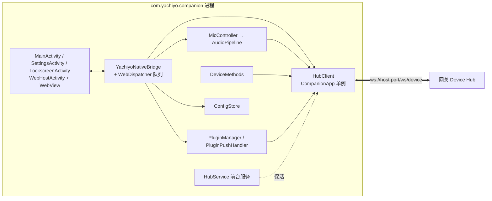

# Android 原生壳（Kotlin）

> 类型: feature
> 状态: active
> 负责人: sonnet-ws4
> 更新: 2026-10-12
> 关联: docs/plans/PLAN-android-ws4-android-native.md, docs/plans/PLAN-android-companion-contracts.md (C1/C2/C3/C6/C7), apps/android/, docs/testing/TC-android-native.md, docs/testing/TC-android-server-discovery.md

## 1. 概述

`com.yachiyo.companion` 是 Yachiyo 的 Android 客户端原生壳：全屏沉浸式 WebView 宿主（加载 WS5 的 Web 前端）、到电脑端网关 Device Hub 的 WebSocket 长连接（前台服务保活）、`window.YachiyoNative` JS Bridge、原生设备能力（振动/电量/Toast/亮屏/信息）、麦克风上行、插件包安装与本地服务、背景图选择、配置持久化。用户看到的是全屏的 Web 界面；屏幕关闭后连接仍保持，通知栏常驻"已连接到电脑"。

## 2. 行为说明

- **进程与连接**：`HubClient` 由 `CompanionApp` 持有（进程级单例），`HubService`（前台服务，类型 `connectedDevice|mediaPlayback`，录音时升级为含 `microphone`）仅负责保活、常驻通知与锁屏预启动；Activity 不重建连接（设计偏离施工文档的"Activity 绑定服务"，因多个 Activity 共用连接，进程单例更简单可靠）。
- **连接状态机**：`disconnected → connecting → connected`；关闭码 1008 → `unauthorized`（不重试）；其他断线按 1s,2s,4s…30s 指数退避重连；握手成功重置退避、重放订阅与 `rpc.register`。心跳：按 `welcome.heartbeat_ms` 发 `ping`，2 个周期无任何入帧则主动断开并重连。
- **WebView 宿主**：硬件加速层、`mediaPlaybackRequiresUserGesture=false`、禁用 file/content 访问、只允许 `appassets.androidplatform.net` 内导航；debug 构建开启 WebView 远程调试；渲染进程崩溃自动 `recreate()`。入口：存在 `assets/web/index.html` 则加载它，否则加载内置 `assets/fallback/index.html`（桥接测试页）；URL 追加 `?mode=normal|lockscreen`。
- **Bridge 事件排队**：`onPageStarted` 起事件入队（上限 500，溢出丢最旧），`onPageFinished` 后按序冲刷；发送脚本在 `window.__yachiyoNative.dispatch` 尚未定义时写入 `window.__yachiyoQueue`，供前端加载后排空。Activity 销毁时 dispatcher 永久关闭并清空排队消息，已投递到主线程的脚本也会检查宿主与 WebView 是否仍有效。
- **返回键**：原生发 `back` 事件，Web 在 300 ms 内调 `consumeBack()` 则视为已处理；否则默认行为（普通模式 `moveTaskToBack`，设置页 `finish`，作为默认桌面时忽略，锁屏模式请求解锁）。
- **麦克风**：见 §3.4。
- **插件**：见 §3.5。

## 3. 接口与协议

### 3.1 Device Hub 客户端（契约 C1）

`HubClient` 实现 C1.2 信封（`v/type/id/topic/data/from/ts`）、`hello`（含 `device_id`、`mode`、`capabilities`、`screen`）、`sub/unsub/pub`、`rpc.req/res`（8 s 超时 → `-32003`，未连接 → `-32010`）、`rpc.register`。入站 `rpc.req` 先查本地处理器（`device.*`），否则转交 Web 层（`hub.rpc.request`），无监听者则返回 `-32601`。
`hubRpc` 的结果 `result` 为任意 JSON，经 `hub.rpc.result {call_id, result|error}` 返回。

进程内可能同时存在 Main、Settings、Lockscreen 三个 WebView。入站事件与未被原生处理的 RPC 只投递给 `HubClient.currentMode` 对应的渲染宿主：设置页不接收动作 RPC，普通主页面与锁屏页面不会同时应答或播放。监听者以布尔值声明是否接管 RPC，首个接管者后停止分发；无人接管统一回 `-32601`。

每个人物渲染 Activity 在 `onResume` 时把自己的 `mode` 设为当前 Hub 模式，并立即向该 WebView 重放进程内最新 `hub.state`。这覆盖锁屏 Activity 留在独立任务且只进入 paused、没有执行 `onDestroy` 的 ROM 行为；回到 Main 后 owner、设备列表和迁移按钮会按权威快照恢复。

### 3.2 JS Bridge（契约 C2.0 / C2.1 / C2.2）

**注入与令牌门（C2.0）**：`addJavascriptInterface` 会把对象注入所有 frame（含沙箱插件 iframe），因此原生只注入 `window.__YachiyoBridge`（`BridgeGate`），仅两个 `@JavascriptInterface` 方法：`handshake()` 每次主文档加载后**只有第一次**返回 32 字节随机 hex token，之后返回 `""` 并记录告警；`invoke(token, method, argsJson)` 常量时间比较 token，不匹配返回 `{"error":{"code":-32006,"message":"bridge token invalid"}}`，未知方法 `-32601`，参数非数组 `-32602`，处理器异常 `-32603`，否则按名称调用下述 C2.1 方法（`argsJson` 为参数数组）。C2.1 的各方法本身不带 `@JavascriptInterface`，不可被直接调用。令牌在**主文档请求**（`shouldInterceptRequest` 的 `isForMainFrame`）时重置——不能依赖 `onPageStarted`，它异步到达，可能晚于页面首个脚本（真机实测）。宿主页第一个脚本调用 `handshake()` 并把 token 留在闭包里，再由 `nativeShim.js` 构造 `window.YachiyoNative`（见 C2.0）；插件 iframe 是 opaque origin，拿不到闭包，真机验证其 `handshake()` 返回空、`invoke` 被拒。WebView 使用 `MIXED_CONTENT_ALWAYS_ALLOW`（页面源 https，网关 http），导航仍限制在资源域名。内置 fallback 页已改用 handshake/invoke，并内置沙箱 iframe 探针（结果写入 logcat `IFRAME_PROBE`）。

以下为经 `invoke` 暴露的 C2.1 方法集：

C2.1 全部方法均已实现（`getConfig/setConfig/getDeviceInfo/hub*/mic*/pick*/listPlugins/uninstallPlugin/setPluginEnabled/pluginStorage*/openHomeSettings/listLaunchableApps/launchApp/setLockscreenEnabled/setOrientation/openSettings/closeSettings/vibrate/log/consumeBack`），C2.2 全部事件均已实现（`hub.state/hub.event/hub.rpc.request/hub.rpc.result/mic.state/mic.level/config.changed/plugins.changed/picker.result/lifecycle/back`）。实现细节与约定：

- `dispatch` 以**对象**（非字符串）调用：`dispatch({type, data})`。
- `plugins.changed` 的 `data` 为**插件数组**（与 `listPlugins()` 同形）。
- `lifecycle.state` 取 `resume/pause/screen_off/screen_on`，`mode` 为 `normal|lockscreen`。
- `mic.state`：`idle|recording|uploading|error`；按住说话 `micStart→recording`、`micStop→uploading→idle`；连续模式整段会话中，原生在有语音段时 `recording`，段间 `idle`。
- `picker.result {kind:"background"|"plugin", uri?, url?, error?}`；背景 `url` 形如 `https://appassets.androidplatform.net/user/backgrounds/bg-<ts>.<ext>`。
- 额外方法（契约外，向后兼容）：`dismissKeyguard()`（仅锁屏 Activity 有效）。
- `setConfig` 返回 `"ok"` 或 `{"error": "..."}`；合并语义为**递归对象合并、数组整体替换**（比 C2.3 "浅合并"略强：`appearance.background` 等嵌套对象可局部更新）。
- `hubSubscribe/hubPublish/hubRpc/hubRegister` 在锁屏模式下对 `plugin.*` 拒绝（`-32006`/忽略）；`listPlugins` 返回 `[]`、`pluginStorage*` 无效、`pickPluginPackage` 返回错误、`launchApp` 与 `listLaunchableApps` 在锁屏模式禁用。
- Web 宿主注册的插件 RPC 由该 Bridge 实例记录，页面销毁时自动 `rpc.unregister`，避免 WebView 重建后遗留无法应答的 agent 工具。

### 3.3 原生设备方法（契约 C1.6，`expose_as_tool: true`，`scope: device`）

| 方法 | 参数 | 返回 |
|---|---|---|
| `device.vibrate` | `{ms: 10..2000}`（默认 200） | `{ok:true}` |
| `device.battery.get` | — | `{level: 0..100, charging}` |
| `device.toast` | `{text}`（≤200 字） | `{ok:true}` |
| `device.screen.wake` | `{ms: 1000..60000}`（默认 5000） | `{ok:true}` |
| `device.info` | — | `{model, manufacturer, android, sdk, app_version, total_mem_mb, screen}` |

参数越界返回 `-32602`。Live2D 方法（`state.get`、`model.*`、`live2d.action.enqueue`）原样转交 Web 前端，由前端调用 `hubRpcRespond` 应答。

### 3.4 麦克风（契约 C1.7）

`RECORD_AUDIO` 运行时授权（首次 `micStart` 触发；拒绝则 `mic.state{error}`）。`AudioRecord` 16 kHz 单声道 PCM16，50 ms 读取（`mic.level` ≈ 20 Hz），累积为 100 ms（3200 B）块，经 Hub 发 `audio.input.start/chunk/end`（`data_b64`，`reason: released|vad|cancel`）。连续模式：简单能量 VAD（阈值 `max(0.015, 3×噪声底)`，连续 ≥100 ms 触发，300 ms 预滚，静音 ≥800 ms 结束，单段 ≤30 s，语音 <150 ms 视为误触发以 `cancel` 结束）。需要 Hub 已连接，否则 `mic.state{error:"hub not connected"}`。

### 3.5 插件（契约 C3）

- 推送安全：仅处理 `from` 为 `gateway`/`runtime` 的 `plugin.install`（其他设备/插件转发的忽略并记录）；`sha256` 必填；相对 `url` 以配置的服务器补全，绝对 `url` 的 scheme+host+port 必须与配置的服务器一致，否则回 `plugin.install_failed {reason:"foreign_url"}`，bearer 令牌绝不发往其他主机。
- 安装来源：SAF 选择器（`pickPluginPackage`）、网关推送（`plugin.install {plugin_id, version, url, sha256, size}`：携带 `Authorization: Bearer <server.token>` 下载、校验 sha256、安装，回执 `plugin.installed {plugin_id, version}` / `plugin.install_failed {plugin_id, error}`；相对 `url` 以 `http://<host>:<port>` 补全）。
- 安全：拒绝 zip 路径穿越（`..`、绝对路径、反斜杠、规范化后越界）；解压总量 ≤64 MB、条目 ≤2000；manifest 严格校验（id `[a-z0-9._-]{3,64}`，`type: app|widget`，`entry/icon` 为包内相对路径，`sdk` ≤1，权限格式白名单）；manifest 规范化（补默认值、widget 网格值钳制到 1..12）后写回。
- 位置：`files/plugins/<id>/`（代码）、`files/plugin-meta/<id>.json`（`installed_at`、`enabled`）、`files/plugin-kv/<id>.json`（插件 KV，上限 1 MB）；同 id 重装覆盖代码、保留 KV 与启用状态；卸载全部删除。
- 锁屏模式（`mode=lockscreen`）拒绝 `plugin.install`（回 `plugin.install_failed`）、`/plugins/` 路径返回 403。

### 3.6 资源目录（契约 C6）

| URL 前缀 | 来源 |
|---|---|
| `/web/` | `assets/web/` |
| `/sdk/` | `assets/web/sdk/` |
| `/generated/` | `assets/generated/` |
| `/fallback/` | `assets/fallback/`（原生内置测试页） |
| `/plugins/<id>/` | `files/plugins/<id>/`（锁屏模式 403） |
| `/user/` | `files/user/`（背景图在 `user/backgrounds/`，保留最近 5 张） |
| `/appicon/<package>.png` | `PackageManager` 渲染的 144 px 图标（内存 LRU 8 MB） |

## 4. 配置项

SharedPreferences `yachiyo`，键 `config`（JSON，缺省值与契约 C2.3 一致，读取时与默认值合并）与 `device_id`（`android-<uuid>`，首次生成后持久化）。

| 键 | 默认 | 说明 |
|---|---|---|
| `server.host` / `server.port` | `192.168.20.212` / `3000` | 网关地址；`host` 以 `ws://`/`wss://` 开头时直接作为基址 |
| `server.token` | `""` | 配对令牌，作为 `?token=` 传递（URL 编码） |
| `server.auto_connect` | `true` | `HubService` 启动时自动连接 |
| `audio.mic_mode` | `push_to_talk` | `micStart` 未指定模式时使用 |
| `orientation` | `auto` | `auto|portrait|landscape`，启动与变更时应用 |
| `launcher.enabled` | `false` | 仅供 Web 决定 UI 行为 |
| `lockscreen.enabled` | `false` | 开启后息屏时预启动锁屏界面 |
| `device.alias` | `mi6` | `hello.name` |
| 其余（`appearance`、`task_canvas`、`plugins`…） | 见 C2.3 | 原生只存取，不解释 |

## 5. 限制与已知问题

- 仅 `arm64-v8a`；`minSdk 26`，`targetSdk 35`。
- 通知权限（Android 13+）首次启动请求；被拒绝时前台服务仍运行但通知不可见。
- 连续模式 VAD 为简单能量阈值，嘈杂环境可能误触发/不断句，后续可换 WebRTC VAD。
- 前台服务 `microphone` 类型需 App 在前台时启动（Android 14+ 限制）；后台中途启动麦克风可能被系统拒绝。
- `device.screen.wake` 使用已弃用的 `SCREEN_BRIGHT_WAKE_LOCK`，在个别 ROM 上可能无效。
- 不处理开机自启（重启后需手动打开一次 App）。
- 明文 `ws://`（局域网）已允许（`usesCleartextTraffic`）。

## 6. 测试用例

JVM 单元测试位于 `apps/android/app/src/test/java/com/yachiyo/companion/**`：`config/ConfigStoreTest`、`hub/EnvelopeTest`、`hub/HubClientTest`（MockWebServer 假网关）、`bridge/WebDispatcherTest`、`bridge/HubSurfacePolicyTest`、`device/DeviceMethodSpecsTest`、`audio/AudioPipelineTest`、`plugins/PluginTest`、`web/PathSafetyTest`、`launcher/PackageNamesTest`。完整清单与真机手工用例见 `docs/testing/TC-android-native.md`（TC-AND-001～043、050～054）与 `TC-android-server-discovery.md`（TC-AND-044～049）。
