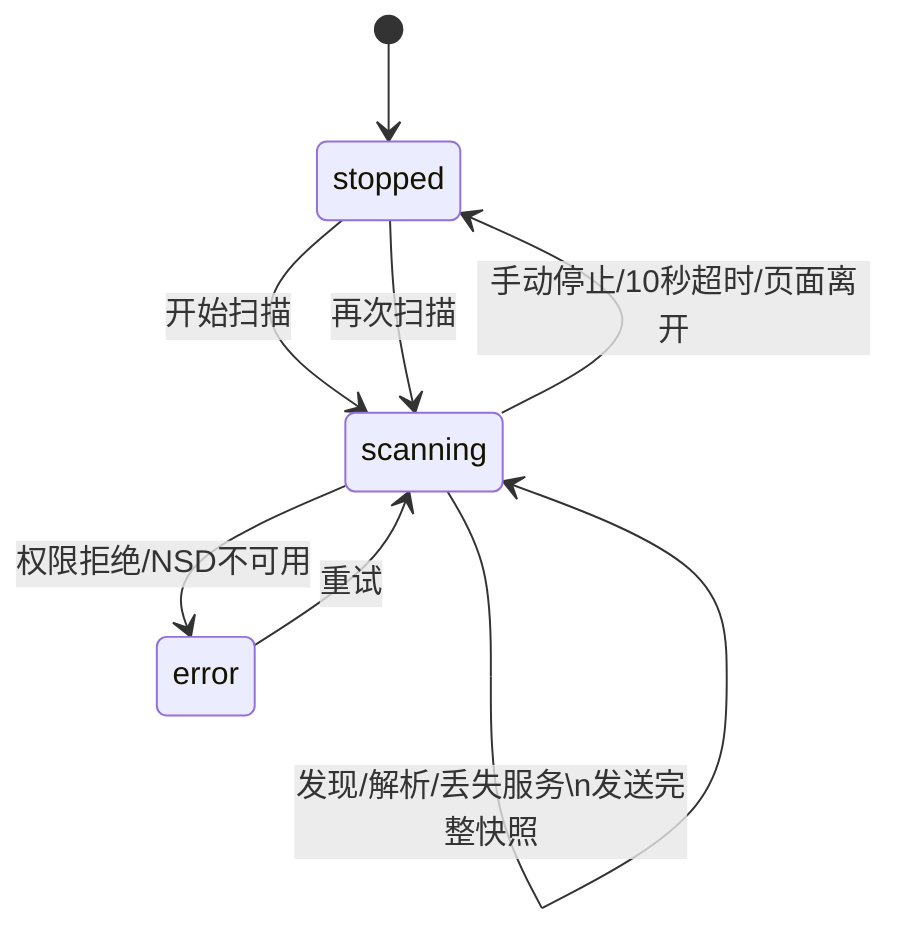

# Android 局域网服务端自动发现

> 类型: feature
> 状态: active
> 负责人: codex-android-integration
> 更新: 2026-10-12
> 关联: docs/plans/PLAN-android-companion-contracts.md §C7, apps/android/app/src/main/java/com/yachiyo/companion/discovery/, docs/testing/TC-android-server-discovery.md

## 1. 概述

Android 配置页可在同一局域网内查找 Yachiyo 网关，显示服务名称与地址，用户点选后填入服务器地址和端口。

## 2. 行为说明

扫描使用 Android NSD / DNS-SD 查询 `_yachiyo._tcp.`，单次最多 10 秒。开始新扫描时清空旧结果；发现、解析或服务丢失后向页面发送当前完整列表。用户可主动停止，设置页暂停或销毁时也会停止并释放 NSD 与 multicast 资源。每次扫描带独立 generation；停止和失败会先使该 generation 失效，再停止原监听者，因此取消后的迟到回调不能污染下一次扫描。即使启动或解析阶段抛错，也会尝试释放已经交给系统的 discovery listener。

候选服务必须同时满足 `version=1`、`path=/ws/device` 和合法端口。地址优先 IPv4，只有 IPv6 时保留 IPv6 字面量；生成 HTTP/WebSocket URL 时再补方括号并编码 scope id。

选择候选只填入 `server.host` 和 `server.port`。若 endpoint 与原配置不同，应用立即清空旧 token 并提示重新配对；相同 endpoint 保留 token。发现本身不会连接候选，也不会信任或保存 TXT 中的额外字段。

## 3. 接口与协议

Web 调用 `YachiyoNative.startServerDiscovery()` 与 `stopServerDiscovery()`。原生分派：

- `server.discovery.state`: `{state, reason?, error?}`，字段取值见契约 C7。
- `server.discovery.results`: `{services:[{id,name,host,port,path,version}]}`，每次发送完整快照。

DNS-SD TXT 只读取 `version` 与 `path`；不得广播或读取 pairing token、API key。

## 4. 配置项

该功能没有持久化开关。扫描固定超时 10 秒，服务类型固定 `_yachiyo._tcp.`。选择服务后写入既有 `server.host`、`server.port`、`server.token`。

## 5. 限制与已知问题

- 只发现同一 multicast 域内广播的网关；访客 Wi-Fi、AP 隔离、VPN 或禁用 multicast 的网络可能无结果。
- 浏览器 mock 环境没有 Android NSD，会显示“不支持服务发现”，仍可手动输入。
- IPv6 link-local 地址依赖系统返回的 scope id；网络切换后应重新扫描。

## 6. 测试用例

见 [TC-android-server-discovery.md](../testing/TC-android-server-discovery.md)：`TC-AND-044` 至 `TC-AND-049`。候选校验、扫描 generation 的启动/取消/迟到回调、URL 与配置选择自动化位于 `ServerDiscoveryTest.kt`、`HubClientTest.kt` 与 `test/android-web/serverAddress.test.js`；Android NSD 与 multicast lock 的系统级释放仍需真机验证。
