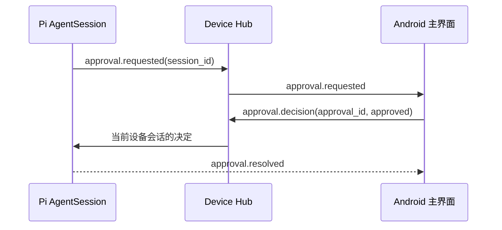

# Android 会话执行权限

> 类型: feature
> 状态: active
> 负责人: Codex（工作流 P5）
> 更新: 2026-10-13
> 关联: apps/android/app/src/main/assets/web/js/sessionApproval.js, apps/gateway/deviceHub/sessionControl.js, docs/features/FEAT-runtime-pi-agent.md, TC-AWB-045..TC-AWB-047

## 1. 概述

Android 主界面提供当前手机 Pi 会话的执行权限入口。用户可以选择逐次询问、自动批准或完全访问，并直接处理等待中的命令请求。

## 2. 行为说明

主界面的盾牌按钮显示当前策略与待处理数量。打开后显示玻璃态权限面板：策略切换立即写入当前 `device-<device_id>` 会话；手动模式收到 `approval.requested` 时显示命令、原因以及允许/拒绝操作；`approval.resolved` 或决定成功后移除请求。面板每次打开都会重新读取服务端状态，从而恢复连接中遗漏的事件。

锁屏模式不展示权限面板。断线时按钮禁用并清除本地待处理副本，重连后从服务端重新同步。

## 3. 接口与协议

Android 只使用 Device Hub 的本地 RPC，目标会话由已认证设备决定，客户端不能传入或修改 `session_id`：

| RPC | 参数 | 返回 |
|---|---|---|
| `session.settings.get` | `{}` | 当前会话设置 |
| `session.settings.update` | `{approval_mode}` | 更新后的会话设置 |
| `approval.pending.list` | `{}` | 当前设备会话待处理列表 |
| `approval.decision` | `{approval_id, approved, scope}` | 决定结果 |

事件：`approval.requested`、`approval.resolved`。所有文本使用 `textContent` 创建，不把命令内容解释为 HTML。

## 4. 配置项

`approval_mode` 属于会话设置而非 Android 永久配置：

| 值 | 默认 | 行为 |
|---|---|---|
| `manual` | 是 | 高风险命令逐次询问 |
| `auto_approve` | 否 | 自动批准需要确认的命令 |
| `full_access` | 否 | 当前会话使用完整设备权限 |

## 5. 限制与已知问题

- 当前界面只提供单次允许/拒绝；长期命令授权仍由策略层管理。
- 策略只作用于当前手机会话，不改变桌面会话。
- 锁屏只能显示人物和使用语音，不提供审批与完整访问切换。

## 6. 测试用例

TC-AWB-045、TC-AWB-046、TC-AWB-047，定义于 `docs/testing/TC-android-web.md`；自动化覆盖 `test/android-web/sessionApproval.test.js`，真机交互按 TC-AWB-047 验证。
