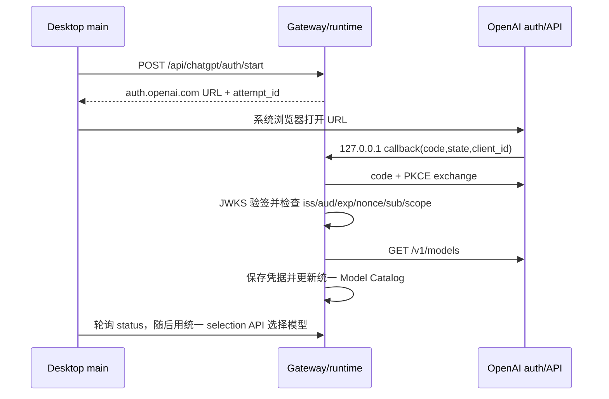

# ChatGPT 订阅用量与模型选择

> 类型: feature
> 状态: active
> 负责人: codex-chatgpt-plan
> 更新: 2026-10-13
> 关联: docs/plans/PLAN-android-companion-contracts.md §C4.5 / docs/plans/PLAN-llm-chatgpt-plan.md / docs/testing/TC-llm-chatgpt-plan.md

## 1. 概述

Yachiyo 继续使用 pi AgentSession、工具循环和本地会话，同时允许用户在电脑端通过 Continue with ChatGPT 连接合资格的 ChatGPT Plus / Pro 账户、选择该账户可见模型，并用 ChatGPT plan allowance 调用公开 Responses API。

## 2. 行为说明

电脑端发起授权后，gateway 先同步预留唯一 attempt，再在 `127.0.0.1` 随机端口启动短期 callback listener，为本次 attempt 生成 state、OIDC nonce 与 PKCE。首次连接使用动态 client 注册；已有 profile 使用已签发 client ID 与非敏感 `login_hint` 复登，授权 URL 不携带已保存的 ID token。回调经过 state、client ID 与 ID token 验证后才原子保存凭据，并刷新所选账户的模型目录。ID token 只要带有 `azp`，其值就必须等于当前 client ID；多 audience 时 `azp` 必须存在。

attempt 同时只允许一个，默认五分钟过期；同步 reservation 防止并发 start 各自留下 listener，创建/listen 失败、取消、过期、完成都会关闭 listener 并清除内存状态。access token 临近到期时按 profile 串行 refresh，成功后把 access / rotating refresh token 一起原子替换；refresh 响应中的新 ID token 不会在未重新验证身份的情况下写入。

模型目录或 Responses 请求遇到 `401` 时最多强制 refresh 并重试一次；第二次失败直接返回。`429`、订阅用量限制和权限错误不重试，也不进入 API key provider 的 fallback。

推理仍由 pi 执行。ChatGPT 模型映射到 pi-ai 1.1.0 的 `openai-responses`，完整本地会话历史作为 `input` 发送；请求固定 `store:false`、`stream:true`。Yachiyo 的 function/custom 工具放进 `yachiyo` namespace，工具实际在本地 pi runtime 执行。

## 3. 接口与协议

所有路由只接受真实 loopback socket 地址（`127.0.0.1`、`::1`、IPv4-mapped loopback），不信任 `X-Forwarded-For`，并要求 `Host` 为与 socket local port 一致的 `localhost` / `127.0.0.1` / `[::1]` authority。浏览器写请求还必须具有与 Host 完全一致的非 null `Origin`，若带 `Sec-Fetch-Site` 只能为 `same-origin` / `none`；缺少所有浏览器来源头的本地 HTTP 客户端保持兼容。响应使用 `{ok:true,data}` 或 `{ok:false,error}`。

| 方法 | 路径 | 说明 |
|---|---|---|
| GET | `/api/chatgpt/status` | 脱敏连接状态、多 profile、pending attempt 与最近错误；不含任何 token、subject 或 client ID |
| POST | `/api/chatgpt/auth/start` | `{profile_id?}` → `{authorization_url,attempt_id}`；Electron main 仅允许打开 `https://auth.openai.com` origin |
| POST | `/api/chatgpt/auth/cancel` | `{attempt_id}`；只能取消当前匹配 attempt |
| POST | `/api/chatgpt/signout` | `{profile_id?}`；发现并验证 OpenAI revocation endpoint，随后清除本地 token |
| POST | `/api/chatgpt/models/refresh` | `{profile_id?}`；成功后把该 profile 设为 active，只保留 `/v1/models` 中 `visibility:"list"` 的 `{slug,display_name}` |
| GET / PUT | `/api/config/models`、`/api/config/models/selection` | ChatGPT 模型与其他 provider 共用的唯一模型目录和选择状态 |

status 的 `pending` 固定为 `null` 或 `{attempt_id,state:"waiting"|"completing",started_at}`。profile 只含 `{id,email,name,connected,plan_usage_enabled,expires_at}`。

## 4. 配置项

| 键 / 路径 | 默认值 | 说明 |
|---|---|---|
| `YACHIYO_HOME` | `~/yachiyo` | 凭据根目录从 runtime paths 解析 |
| `data/chatgpt-auth/host.json` | 首次生成 | 稳定 `ext_agent_host_id`，不含账户 token |
| `data/chatgpt-auth/profiles/*.json` | 无 | 每个动态 client/已验证 identity 独立存储，Unix `0600` |
| provider key | `chatgpt` | 固定 `openai_chatgpt_plan` / `openai-responses` / `https://api.openai.com/v1` |
| attempt TTL | 5 分钟 | 当前为服务构造参数，生产默认五分钟 |

`providers.yaml` 仅缓存模型 slug/display name 与统一 selection，不存 OAuth token，也不允许为 ChatGPT provider 写自定义 base URL、headers 或 API key。

## 5. 限制与已知问题

- 当前公开 npm registry 没有 `@siwc/local` / `@siwc/core` 包（2026-10-13 查询为 404），因此本实现按官方 OAuth/OIDC 协议直接实现，并使用 Node crypto 验签。
- ChatGPT plan usage 只用于 OpenAI 官方允许的开源、本地运行场景。授权不会读取 ChatGPT 对话，也不会取得用户 API key。
- HTTP Responses 请求不使用 `previous_response_id`；本地 pi 会话负责历史。预览路由不支持的托管工具和请求字段会被移除或拒绝。自动化覆盖 namespaced function call、本地执行和 `function_call_output` 回放的完整两轮链路。
- `subscription_sharing_usage_limit_exceeded`、用量状态不可用、身份/权限/策略和 unsupported capability 等错误会终止当前推理，不会静默切换到 API key 计费 provider；任何上游错误文本都不会带出请求 Authorization。
- 本轮只做 mock/OIDC 离线验证；真实账户登录和真实模型推理由统筹者在可审查 UI 就绪后验收。

实现依据：[Registration and sign-in](https://developers.openai.com/siwc/token-sharing-open-source/sign-in)、[Models and inference](https://developers.openai.com/siwc/token-sharing-open-source/models-and-inference)、[Preview limitations](https://developers.openai.com/siwc/token-sharing-open-source/preview-limitations)、[Errors and recovery](https://developers.openai.com/siwc/token-sharing-open-source/errors-and-recovery)。

## 6. 测试用例

TC-LLM-029 ~ TC-LLM-039，见 `docs/testing/TC-llm-chatgpt-plan.md`。自动化位于 `test/runtime/auth/chatgpt.test.js`、`test/runtime/agent-pi/modelAdapter.test.js`、`test/runtime/config/` 与 `test/gateway/chatgptAuthRoutes.test.js`。
