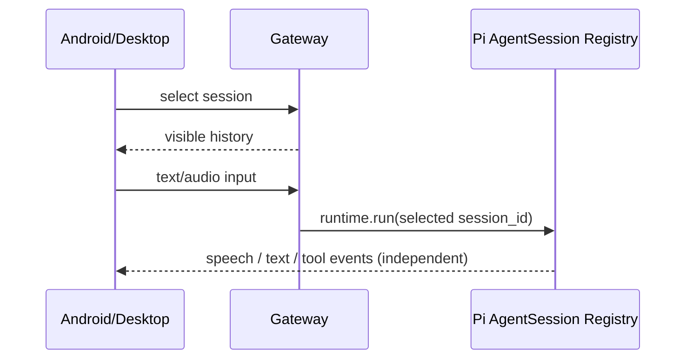

# 跨端聊天会话与交互反馈

> 类型: feature
> 状态: active
> 负责人: Codex
> 更新: 2026-10-13
> 关联: apps/gateway/deviceHub/sessionControl.js, apps/desktop-live2d/renderer/chat.js, apps/android/app/src/main/assets/web/js/sessionHistory.js, TC-HUB-033, TC-HUB-034, TC-AWB-052, TC-AWB-053, TC-AWB-054, TC-AWB-055, TC-AWB-056, TC-DSK-029, TC-PI-048

## 概述

手机可从顶部下拉查看本机历史会话，桌面聊天窗提供常驻会话侧栏；切换后真正复用对应的长生命周期 Pi AgentSession。

## 行为说明

手机只显示默认 `device-<id>` 和该设备创建的派生会话，桌面只显示 `desktop-*` 会话。选择会话会同时切换聊天、音频、Realtime、审批和工具执行上下文。历史列表只展示用户与助手可见消息，不暴露系统提示、工具参数和内部事件。

手机从屏幕上方约 22% 的宽松手势区下拉时，面板底边连续跟随手指；释放位置未过屏幕中线时吸附半屏，过中线时吸附全屏。输入框下方保留全宽底边抓取区，从屏幕最底边或面板非滚动空白区上推时底边同样跟手，释放位置仍在中线下方时吸附半屏，推过中线时完全收起。聊天气泡、消息滚动区、输入框正文、发送按钮和工具卡会保留自己的交互，不会误触抽屉手势。预览态点击收起按钮或卡片外空白遮罩也会关闭。竖屏会话选项压缩成顶部单行横向栏，横屏改为左侧自上而下排列；横竖屏切换时会话栏、历史和输入区以淡出、位移、淡入完成重排。面板底部输入框直接向当前会话发送消息，Enter 发送、Shift+Enter 换行。历史消息以安全 Markdown 渲染标题、列表、引用、代码、表格和 `http/https/mailto` 链接，原始 HTML 与危险协议只按普通文本显示。

Agent 的交互规则要求长任务先给出简短回应，适合语音时优先说话；工具执行期间可反馈进度，完成后必须说明实际结果。音频、文字和工具状态使用独立通道：文字通过 `ui.chat.post` 或 final fallback，工具卡不进入消息气泡。

## 接口与协议

手机使用 C1.6 的 `session.list/history/create/select` RPC。桌面通过受限 Electron IPC 调用 GatewayRuntimeClient 的列表、读取和选择方法。服务端验证会话命名空间，客户端发送聊天时不能直接覆盖 session_id。

## 配置项

手机列表默认最多 40 条、允许上限 80 条；历史最多返回最近 200 条可见消息。桌面侧栏最多读取 80 条。手机历史预览高度为竖屏 50vh、横屏 82vh（横屏标题和状态栏同步压缩），第二段为 100% 高度；拖拽释放以视口 50% 中线决定吸附方向。工具完成/失败卡片 8 秒后收起；完整聊天气泡约 10 秒后收起。

## 限制与已知问题

手机当前会话选择只保存在本次 Device Hub 连接中，断线重连后回到默认设备会话；用户可从历史面板重新选择。会话标题由首条用户消息自动生成，目前不支持手动重命名。

## 测试用例

- [TC-device-hub-bus.md](../testing/TC-device-hub-bus.md)：TC-HUB-033、TC-HUB-034
- [TC-android-web.md](../testing/TC-android-web.md)：TC-AWB-052～056
- [TC-desktop-shell-and-chat.md](../testing/TC-desktop-shell-and-chat.md)：TC-DSK-029
- [TC-runtime-pi-agent-core.md](../testing/TC-runtime-pi-agent-core.md)：TC-PI-048
