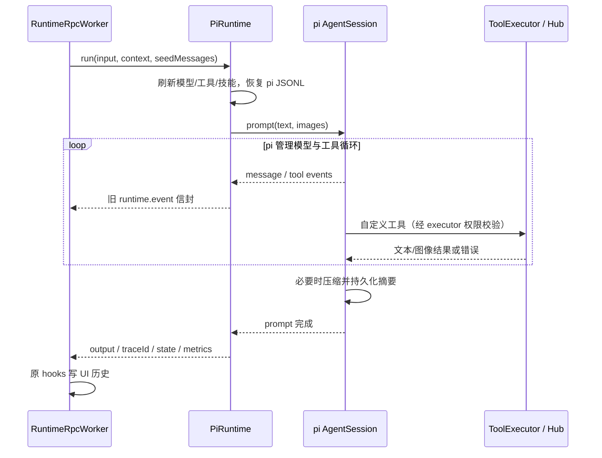

# pi Agent 核心

> 类型: feature
> 状态: active
> 负责人: Codex (gpt-6-astra)
> 更新: 2026-10-12
> 关联: ../plans/PLAN-android-ws1-pi-core.md, ../plans/PLAN-android-companion-contracts.md §C4/§C5, ../testing/TC-runtime-pi-agent-core.md, ../../apps/runtime/agent-pi/

## 1. 概述

聊天默认由 pi 1.1.0 执行 Agent 循环、上下文压缩、技能和会话持久化；网页、桌面和手机继续使用原 runtime.run、流式回复、工具进度及会话历史协议。设置 `AGENT_CORE=legacy` 并重启网关可回滚。

## 2. 行为说明

每次 run 重新读取 Model Catalog、skills.yaml 和设备方法；同一 session 串行，session_id 的 SHA-256 对应固定 pi JSONL。恢复由 SessionManager 完成，旧 UI 历史只在首次建立 pi 会话时导入。系统 memory SOP/bootstrap seeds 随 pi 会话保留，后续不会重复导入 user/assistant seeds。

模型以请求覆盖、会话覆盖、active 的顺序选择，继而使用 catalog.fallbackChain() 去重。仅网络/超时/429/5xx 且尚未输出文本、未启动工具时尝试后续模型；401、工具执行后的失败不会回退重放。错误以 ERROR 状态返回。步数和工具错误次数有上限。

PersonaContextBuilder、旧核心语音回复、persona 修改、截图规则和 memory system seeds 保留；每轮加入权限说明。low 权限不注入 SOP/bootstrap seeds。技能先按原有来源优先级、enabled、eligibility 筛选，再由 pi 解析；使用 pi 官方 formatter 显式展示技能清单，因为内置 read/bash 禁用后 pi 不会自动展示它们。

用户图片转换成 pi image blocks；图片不经过 pi 自动缩放，网关沿用原有大小限制。v1 模型缺少视觉元数据时仍发送用户显式图片，由 provider 判断能力。desktop.capture 工具结果附加实际图像。网关仍先执行现有 ASR；直接使用工厂时可注入 transcribeAudio，或提供 inputAudio.transcribed_text。

## 3. 接口与协议

`await createPiRuntime({ bus, executor, modelCatalog, deviceHub, personaContextBuilder, sessionStore, ... })` 返回具有 `run()` 的运行器。modelCatalog/deviceHub 也可为每次调用获取最新对象的函数。

`run({ sessionId, input, inputImages, inputAudio, seedMessages, runtimeContext, permissionLevel, model_ref, modelRef, signal, onEvent })` 返回 `{ output, traceId, state, metrics }`。模型覆盖优先级：model_ref → modelRef → runtimeContext.model_ref → session settings.model_ref → catalog.active。

事件保留 `{trace_id,session_id,task_id:null,step_index,seq,event,source:'runtime',latency_budget_ms:1200,payload}`：

| 事件 | 主要 payload |
|---|---|
| plan | input、input_images、max_step、context_messages、persona_mode、skills_selected、runtime_flags |
| llm.stream.start/end | mode: decision_stream |
| llm.stream.delta | delta |
| tool_call.delta/stable | index/delta 或 call_id/name/args |
| tool.call、tool_call.requested/started | call_id、name、args、dispatch_mode: pi |
| tool.result、tool_call.completed/failed | call_id、name、result、error；失败保留 code |
| llm.final | decision（type、preview 或 tools）、streamed、stream_meta |
| done | output、state、metrics |
| tool.error | error |
| llm.fallback | from、to（模型引用，不含凭证） |
| pi.compaction_start/end | reason、aborted、error |

bus 另发 runtime.start、message.delta、runtime.final、runtime.error；原 worker 继续将事件映射到 WS runtime.start/message.delta/tool_call.event/runtime.final。pi 工具直接调用 executor，不发布 dispatcher 的 tool.call.requested 命令，避免重复执行。

| 新工具 | 参数 | 路由 |
|---|---|---|
| bus_publish | `{topic,data}` | 仅 plugin./avatar./ui./task.，经 publishEvent 附上下文 |
| avatar_status | `{}` | Hub.getAvatarHost/listDevices |
| avatar_transfer | `{to}` | Hub.requestAvatarTransfer(to, {reason:'agent'}) |
| Hub 暴露的方法 | C5 params_schema | invoke(device_id, method, params, {timeoutMs:8000}) |

设备工具集在请求边界取快照；tools.changed 标记下一快照刷新，不改变已经执行中的定义。可注入 avatar 控制器用于测试。内置工具全部排除，只有现有 registry 和上述桥接工具可用。

## 4. 配置项

| 键 / 工厂参数 | 默认 | 范围与说明 |
|---|---|---|
| AGENT_CORE | pi | pi / legacy；其他值启动失败 |
| YACHIYO_HOME | ~/yachiyo | 现有运行时根目录 |
| PI_SESSION_STORE_DIR / sessionDir | data/pi-sessions | 覆盖 pi JSONL 根目录；自定义 sessionStore 根目录时使用其同级 pi-sessions |
| RUNTIME_MAX_STEP / maxStep | 128 | 正整数，模型轮次数上限 |
| RUNTIME_TOOL_ERROR_MAX_RETRIES / toolErrorMaxRetries | 5 | 正整数，工具失败预算 |
| RUNTIME_STREAMING_ENABLED | true | false 时保留 llm.final，由 worker 按原协议发送 final preview |
| compaction.enabled | true | 工厂布尔参数，交给 pi 自动压缩 |
| compaction.reserveTokens | 16384 | 工厂非负整数 |
| compaction.keepRecentTokens | 20000 | 工厂非负整数 |
| mirrorHistory | true | 直接运行可镜像 FileSessionStore；网关强制 false，保留原 hooks |
| providers.yaml C4 字段 | Model Catalog | api、reasoning、input、headers、compat、extra_body、timeout_ms、max_retries、temperature |
| skills.yaml | 现有规则 | workspace/global/extraDirs、entries.enabled、eligibility |
| tools.yaml policy | 原配置 | 所有工具保留 allow/deny；非空 allowlist 需加入 bus_publish、avatar_status、avatar_transfer 及需要的设备工具名 |

ESM 包仅经 loadPi 动态加载并缓存。三个 pi 包精确固定为 1.1.0。ModelRuntime 凭证和目录缓存使用内存，不读取 ~/.pi 用户凭证，不联网刷新模型目录。关闭外部 pi 扩展、模板和开发仓库上下文的自动加载。

## 5. 限制与已知问题

- WS2 负责 RPC 的 model_ref 透传及 settings 持久化；当前兼容装配可转送单次覆盖，持久设置需合并 WS2。
- WS3 未启用时设备离线；Avatar/设备真实行为需合并 WS3 后验收。默认 tools.yaml 非空 allowlist 不含新增工具，统筹需明确加入获准名称；expose_as_tool 不覆盖全局 deny/allow。
- pi 侧工具串行执行，关闭旧核心 early dispatch/parallel 开关。取消可阻止后续调用；正在执行的旧 executor 工具沿用自身超时，不能保证立即中断。
- 降低会话权限不能撤回已经进入历史的内容；本次 low 规则控制新注入和新工具访问。
- 图片 provider 必须实际支持视觉。真实云 provider 兼容性及 Android 设备未在 WS1 联网/真机验证；测试全部使用本地 mock。
- package-lock.json 由统筹合并时更新；更新前不要用旧锁文件执行 npm ci。会话 JSONL 包含对话和工具结果，按现有用户数据目录保护。

## 6. 测试用例

完整步骤及自动化映射见 [TC-runtime-pi-agent-core.md](../testing/TC-runtime-pi-agent-core.md)：TC-PI-001…024，覆盖模型、权限、设备刷新、prompt 等价、会话恢复、技能、流式事件、图片/音频、回退、循环限制、双模式网关及实际压缩。

`npm run test:ci` 最终 535 项通过（基线 509；新增 26）。TC-PI-021 额外在子进程分别完整执行既有 gateway.e2e 的五项测试，确认子进程确实运行测试而非空通过。
