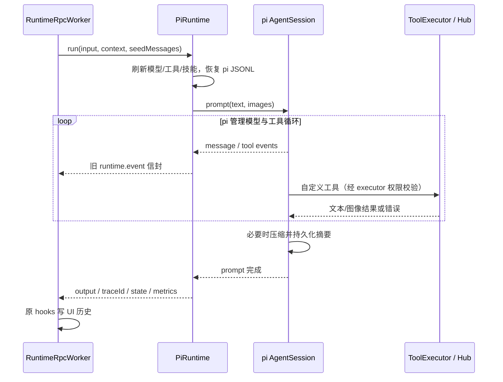

# pi Agent 核心

> 类型: feature
> 状态: active
> 负责人: Codex (gpt-6-astra)
> 更新: 2026-10-13
> 关联: ../plans/PLAN-android-ws1-pi-core.md, ../plans/PLAN-android-companion-contracts.md §C4/§C5, ../testing/TC-runtime-pi-agent-core.md, ../../apps/runtime/agent-pi/

## 1. 概述

聊天默认由 pi 1.1.0 执行 Agent 循环、上下文压缩、技能和会话持久化；网页、桌面和手机继续使用原 runtime.run、流式回复、工具进度及会话历史协议。设置 `AGENT_CORE=legacy` 并重启网关可回滚。

## 2. 行为说明

每次 run 重新读取 Model Catalog、skills.yaml 和设备方法；同一 session 由长生命周期 AgentSession 管理，session_id 的 SHA-256 对应固定 pi JSONL。恢复由 SessionManager 完成，旧 UI 历史只在首次建立 pi 会话时导入。系统 memory SOP/bootstrap seeds 随 pi 会话保留，后续不会重复导入 user/assistant seeds。

模型以请求覆盖、会话覆盖、active 的顺序选择，继而使用 catalog.fallbackChain() 去重。仅网络/超时/429/5xx 且尚未输出文本、未启动工具时尝试后续模型；401、工具执行后的失败不会回退重放。错误以 ERROR 状态返回。步数和工具错误次数有上限。RuntimeRpcWorker 会并发把同一会话的新输入交给长生命周期 AgentSession：显式用户纠正使用 Pi 原生 `steer`，普通文字使用 `followUp`。steer 在当前 assistant turn 的工具结束后、下一次模型调用前插入。新的手机语音采用“最新输入优先”：worker 通过 Pi 当前 run 的 `AbortSignal` 取消旧模型、审批等待和支持取消的工具，等待旧 run 以 `ABORTED` 完整收口，再把新语音送入同一个 `AgentSession`；尚在上下文准备阶段的旧请求也会被跳过。每个输入拥有独立 trace、事件和最终结果。音频 turn 默认最长 90 s，其他 turn 默认最长 180 s。

PersonaContextBuilder、旧核心语音回复、persona 修改、截图规则和 memory system seeds 保留；每轮加入权限说明。low 权限不注入 SOP/bootstrap seeds。技能先按原有来源优先级、enabled、eligibility 筛选，再由 Pi 解析并通过标准 Skills 区段展示。项目工作目录中的 `AGENTS.override.md`、`AGENTS.md` 或 `CLAUDE.md` 按 Pi 原生祖先目录规则加载一次；Yachiyo prompt、项目 context 与 Skills 各自占独立区段，不重复拼接。

语音自动回复开启时，prompt 会标明本轮输入来自文字或音频。模型判断适合语音后，`voice.tts_aliyun_vc` 必须成为本轮第一个可观察动作，先于 Live2D、搜索、截图和其他工具：可立即口述短答案；如果仍需调用工具，则先口述简短确认，再继续处理。`force_on` 模式对所有非空用户回复强制采用同一顺序。音频输入、短对话、问候、确认与情感回应具有较高语音优先级；代码、表格、链接密集内容和详细排障仍保持文字输出。默认限流为同一会话间隔 0.5 秒、每分钟 12 次，以支持连续一问一答。

发给模型 provider 的工具名统一满足 `^[a-zA-Z0-9_-]{1,64}$`：合法名称保持不变，名称中的 `.` 优先编码为 `__`，其他非法字符按 UTF-8 字节编码，过长名称使用稳定摘要；候选冲突时追加稳定摘要。桥接对象保留原名，实际 executor 调用、publishEvent、兼容事件和 Live2D/TTS 单次调用控制均使用原名。pi 内部为旧兼容 provider 返回的原始点号名保留隐藏声明，原名不会出现在发送给 provider 的工具 schema 中。

用户图片转换成 pi image blocks；图片不经过 pi 自动缩放，网关沿用原有大小限制。v1 模型缺少视觉元数据时仍发送用户显式图片，由 provider 判断能力。desktop.capture 工具结果附加实际图像。网关仍先执行现有 ASR；直接使用工厂时可注入 transcribeAudio，或提供 inputAudio.transcribed_text。

## 3. 接口与协议

`await createPiRuntime({ bus, executor, modelCatalog, deviceHub, personaContextBuilder, sessionStore, ... })` 返回具有 `run()` 的运行器。modelCatalog/deviceHub 也可为每次调用获取最新对象的函数。

`run({ sessionId, input, inputImages, inputAudio, seedMessages, runtimeContext, permissionLevel, model_ref, modelRef, deliveryMode, signal, onEvent })` 返回 `{ output, traceId, state, metrics }`。模型覆盖优先级：model_ref → modelRef → runtimeContext.model_ref → session settings.model_ref → catalog.active。

会话设置 `approval_mode` 可取 `manual|auto_approve|full_access`。本机界面使用 `PUT /api/sessions/:sessionId/settings` 更新；`GET /api/approvals?session_id=...` 列出待处理项，`POST /api/approvals/:approvalId/decision` 以 `{session_id,approved,scope:'once'|'always'}` 决定。手机订阅 `approval.**`，并调用 `session.settings.get/update`、`approval.pending.list/decision` Device Hub RPC；服务端不接受手机提供 session_id，固定使用已认证设备对应的会话。

同一 `sessionId` 由 `AgentSessionRegistry` 复用一个长生命周期 Pi `AgentSession`。默认最多驻留 32 个会话，空闲 30 分钟后回收内存对象；Pi JSONL 会话不删除，后续请求从原 `SessionManager` 恢复。每次运行的 `plan` 与 `metrics` 同时记录 `requested_model_ref` 和 `resolved_model_ref`，用于区分界面选择、会话覆盖、全局默认和 fallback 的实际结果。

RPC `params.delivery_mode` 可选 `steer|followUp`。未指定时，音频输入标记为 `steer`，文字输入默认 `followUp`。同一会话的新音频会先执行即时取消与会话串行重入；其他 steer/followUp 继续使用 Pi 原生队列。每条排队输入由 `TurnCoordinator` 在 Pi user message 边界激活，工具上下文、流式 delta、tool_call 事件和 final 不跨请求串线；队列最后一条输入等待 `agent_settled` 后返回。忙碌判断同时检查 Pi `agent.signal`、Session streaming 状态和 TurnCoordinator，工具阶段不会再误调用第二次 `prompt()`。

事件保留 `{trace_id,session_id,task_id:null,step_index,seq,event,source:'runtime',latency_budget_ms:1200,payload}`：

| 事件 | 主要 payload |
|---|---|
| plan | input、input_images、max_step、context_messages、persona_mode、skills_selected、runtime_flags |
| llm.stream.start/end | mode: decision_stream |
| llm.stream.delta | delta |
| tool_call.delta/stable | index/delta 或 call_id/name/args |
| tool.call、tool_call.requested/started | call_id、name、args、dispatch_mode: pi |
| tool.result、tool_call.completed/failed | call_id、name、result、error；失败保留 code |
| llm.final | decision（type、preview 或 tools）、streamed、stream_meta |
| done | output、state、metrics |
| tool.error | error |
| llm.fallback | from、to（模型引用，不含凭证） |
| pi.compaction_start/end | reason、aborted、error |

bus 另发 runtime.start、message.delta、runtime.final、runtime.error；原 worker 继续将事件映射到 WS runtime.start/message.delta/tool_call.event/runtime.final。pi 工具直接调用 executor，不发布 dispatcher 的 tool.call.requested 命令，避免重复执行。

工具批次使用 Pi 原生并行调度。`side_effect_level` 为 `none` 或 `read` 且 `requires_lock=false` 的工具可以同批并发；写操作、未知副作用和显式锁会把整批降为串行。动态 Device Hub 方法默认按写操作处理，只有设备声明安全调度元数据后才能并行。TTS、Live2D 与屏幕捕获保留现有锁，因此不会产生重叠播放、动作状态竞争或并发截图。

工具审批位于 `ApprovalCoordinator`，不进入模型上下文。`shell.approve` 从 Pi 可见工具目录中移除；`shell.exec` 返回 `APPROVAL_REQUIRED` 后，桥接层按当前会话策略等待用户、自动签发一次性许可，或在 full access 下直接执行，再把唯一一次最终工具结果交回 Pi。`manual` 的待审批项通过 HTTP 与 Device Hub 的 `approval.requested`/`approval.decision` 交互；审批 ID 必须同时匹配当前 session，手机只能决定自己的 `device-<device_id>` 会话。

三种审批模式与普通 `permission_level` 分离。`manual` 保留逐次确认；`auto_approve` 只自动确认 shell operator，仍受原权限级别、工作区、工具 allow/deny 与设备 ACL 约束；`full_access` 同时采用 high 权限、允许文件及 shell 路径离开会话工作区，并跳过 operator 逐次确认。三种模式都保留参数 schema、工具全局 deny、设备归属/协议 ACL 以及 sudo、根目录递归删除、关机/重启等硬阻断。

| 新工具 | 参数 | 路由 |
|---|---|---|
| bus.publish | `{topic,data}` | 仅 plugin./avatar./ui./task.，经 publishEvent 附会话上下文 |
| bus.subscribe | `{pattern,delivery,priority,ttl_ms,max_queue,include_self}` | 会话级订阅；默认进入 pull 队列，steer 必须显式 high priority |
| bus.unsubscribe | `{subscription_id}` | 只删除当前 AgentSession 的订阅 |
| bus.events.pull | `{after_cursor,limit,acknowledge}` | 拉取有界事件队列并返回单调 cursor、pending 与 dropped_events |
| bus.channels.list | `{}` | 列出本会话订阅和观察到的安全频道，不暴露 runtime/tool 内部频道 |
| avatar_status | `{}` | Hub.getAvatarHost/listDevices |
| avatar_transfer | `{to}` | Hub.requestAvatarTransfer(to, {reason:'agent'}) |
| Hub 暴露的方法 | C5 params_schema | invoke(device_id, method, params, {timeoutMs:8000}) |

设备工具集在请求边界取快照；tools.changed 标记下一快照刷新，不改变已经执行中的定义。动态方法必须来自 Hub 的已配对且 `expose_as_tool:true` 列表，并匹配 `policy.deviceHub.allow` 且不匹配 `policy.deviceHub.deny`；匹配后仅将实际方法名加入本次 executor 精确 allow。全局 deny、provider deny 和会话权限仍优先。可注入 avatar 控制器用于测试。

Pi 标准 `read`、`bash`、`edit`、`write`、`grep`、`find`、`ls` 以原生 schema、输出截断、diff 和提示词贡献注册。`grep`、`find`、`ls` 使用 Pi 的专用只读实现并遵守会话文件边界，避免模型为了目录探索反复拼接 shell 命令；它们与 `read` 可并行。write/edit 默认不能越界，bash 通过 `shell.exec` 和 `ApprovalCoordinator`，因此不会绕过 allow/deny、危险命令阻断或审批策略。bash/edit/write 串行。Pi 会话不再向模型重复声明 `shell.exec` 与 `workspace.write_file`，但两者继续作为标准 bash/write 的策略后端。Apple Music 没有任何专用工具名，只通过 `apple-events-music` Skill 指示 Pi 使用标准 read/bash 执行脚本。

Qwen Realtime 作为 `qwen-realtime` Pi provider 注册。adapter 只转换 Pi transcript、tools 与 provider 事件，并将 24 kHz PCM 作为独立 side channel 发布；function call 必须先转成 Pi `toolCall`，再经过同一 ToolCatalog、ApprovalCoordinator 和 AgentSession 执行。Realtime 采集入口只负责把 PCM 封装为受限 WAV，不注册工具、不创建回答。原始音频引用作为 Pi user message 的扩展字段进入同一个 `device-<id>` 会话，再由 provider 映射为 `input_audio`；转写事件只用于 UI 展示，不再触发第二次模型请求。每次请求只把最新且尚未完成消费的语音消息作为二进制 `input_audio` 发送；旧语音轮以转写文本或历史语音占位回放，工具续轮也不会重复上传同一段 PCM，避免长生命周期会话在第二轮被 Realtime 服务端断开。

## 4. 配置项

| 键 / 工厂参数 | 默认 | 范围与说明 |
|---|---|---|
| AGENT_CORE | pi | pi / legacy；其他值启动失败 |
| YACHIYO_HOME | ~/yachiyo | 现有运行时根目录 |
| PI_SESSION_STORE_DIR / sessionDir | data/pi-sessions | 覆盖 pi JSONL 根目录；自定义 sessionStore 根目录时使用其同级 pi-sessions |
| RUNTIME_MAX_STEP / maxStep | 128 | 正整数，模型轮次数上限 |
| RUNTIME_TOOL_ERROR_MAX_RETRIES / toolErrorMaxRetries | 5 | 正整数，工具失败预算 |
| RUNTIME_VOICE_RUN_TIMEOUT_MS | 90000 | 手机音频 turn 的总执行时限；新语音仍会提前打断同 session 旧 turn |
| RUNTIME_RUN_TIMEOUT_MS | 180000 | 非音频 turn 的总执行时限 |
| RUNTIME_SESSION_IDLE_TTL_MS | 1800000 | 长生命周期 AgentSession 的空闲内存驻留时间；回收不删除 Pi JSONL |
| RUNTIME_MAX_RESIDENT_SESSIONS | 32 | 同时驻留内存的 AgentSession 上限；只回收非 busy 的最久未使用会话 |
| tools[].side_effect_level | 未知 | `none` / `read` 可参与 Pi 并行；`write` 与未知值串行 |
| tools[].requires_lock | false | true 时强制所在工具批次串行 |
| session.settings.approval_mode | manual | manual / auto_approve / full_access；full_access 同时将执行权限提升为 high |
| ApprovalCoordinator.timeoutMs | 120000 | manual 待审批时限；超时或会话取消后以 PERMISSION_DENIED 收口 |
| RUNTIME_STREAMING_ENABLED | true | false 时保留 llm.final，由 worker 按原协议发送 final preview |
| compaction.enabled | true | 工厂布尔参数，交给 pi 自动压缩 |
| compaction.reserveTokens | 16384 | 工厂非负整数 |
| compaction.keepRecentTokens | 20000 | 工厂非负整数 |
| mirrorHistory | true | 直接运行可镜像 FileSessionStore；网关强制 false，保留原 hooks |
| providers.yaml C4 字段 | Model Catalog | api、reasoning、input、headers、compat、extra_body、timeout_ms、max_retries、temperature |
| skills.yaml | 现有规则 | workspace/global/extraDirs、entries.enabled、eligibility |
| tools.yaml policy | 原配置 | 所有工具保留 allow/deny；非空 allowlist 需加入 bus.publish/subscribe/unsubscribe/events.pull/channels.list、avatar_status、avatar_transfer 及需要的设备工具名 |
| Pi 标准工具 | read / bash / edit / write / grep / find / ls | 原生定义 + Yachiyo 受控边界与 operations；`shell.exec`、`workspace.write_file` 仅作策略后端，不重复暴露给模型 |
| voice-policy.yaml auto_reply.enabled | true | 缺少配置文件时也默认启用策略模式；会话 `/voice off` 可覆盖为关闭 |
| voice-policy.yaml limits | 0.5 秒 / 12 次每分钟 | TTS 会话冷却与全局分钟上限；内容适用性规则仍优先 |
| tools.yaml policy.deviceHub.allow | `[]` | 动态 Hub 工具名的 `*` 通配模式；空数组表示不暴露任何动态方法 |
| tools.yaml policy.deviceHub.deny | `[]` | 动态 Hub 工具名的 `*` 通配拒绝模式，优先于 deviceHub.allow |

ESM 包仅经 loadPi 动态加载并缓存。三个 pi 包精确固定为 1.1.0。ModelRuntime 凭证和目录缓存使用内存，不读取 ~/.pi 用户凭证，不联网刷新模型目录。当前阶段仍关闭外部 pi 扩展、模板和开发仓库上下文的自动加载；恢复标准资源发现由 `PLAN-runtime-pi-session-v2.md` 的 P2 单独施工和验收。

## 5. 限制与已知问题

- RuntimeRpcWorker 原生透传单次 `model_ref`，会话 settings 提供持久覆盖；gatewayAssembly 的旧兼容入口仅保留为无操作导出，待网关装配移除调用后删除。
- AgentSession 忙碌时不能切换模型；带不同 `model_ref` 的排队输入会返回明确错误，客户端应在当前 turn settled 后重试选择。
- `shell.approve` 仍保留在 legacy 回滚核心的工具注册表中；Pi 核心不会把它发给 provider。legacy 模式尚未获得本节的策略层审批语义。
- WS3 未启用时设备离线；Avatar/设备真实行为需合并 WS3 后验收。默认 tools.yaml 非空 allowlist 不含新增工具，统筹需明确加入获准名称；expose_as_tool 不覆盖全局 deny/allow。
- Pi 使用副作用感知的批次并行；当前没有额外的并发宽度上限，批次大小由模型单次响应决定。取消可阻止后续调用，并会终止 `shell.exec` 子进程；其他工具只有在 adapter 遵守传入的 `AbortSignal` 时才能立即停止，已经提交到外部设备的副作用不能撤销。
- EventBus 订阅最多 32 个、单订阅 TTL 最长 1 小时、会话队列最多 512 条、单事件最大 64 KiB。只接受 plugin/device/avatar/audio/voice/task/ui/client/sys 命名空间；带其他 session_id 的内部事件不会跨会话投递，设备来源事件可进入订阅。订阅随驻留 AgentSession 回收，不作为永久后台任务恢复。
- 降低会话权限不能撤回已经进入历史的内容；本次 low 规则控制新注入和新工具访问。
- 图片 provider 必须实际支持视觉。真实云 provider 兼容性及 Android 设备未在 WS1 联网/真机验证；测试全部使用本地 mock。
- Qwen Realtime 的本机 AgentSession 长期驻留且原始音频直接进入模型；provider adapter 每次模型请求仍会重新建立云端 WebSocket，但只在当前语音首次请求上传 PCM，工具续轮和后续用户轮不会重放历史二进制音频。
- 外部 Pi extensions、MCP、prompt templates 与 themes 仍关闭；Agent 循环、标准 Skills/context、会话和四个标准文件/shell 工具已启用。远程设备与应用能力继续通过 Yachiyo 工具目录接入，避免扩展绕过审批层。
- package-lock.json 由统筹合并时更新；更新前不要用旧锁文件执行 npm ci。会话 JSONL 包含对话和工具结果，按现有用户数据目录保护。

## 6. 测试用例

完整步骤及自动化映射见 [TC-runtime-pi-agent-core.md](../testing/TC-runtime-pi-agent-core.md)：TC-PI-001…043，覆盖模型、权限、设备刷新、provider 合法工具名与原名反向映射、prompt 等价、会话恢复、标准 Skills/context 与文件/shell 工具、流式事件、图片/原始音频、回退、循环限制、双模式网关、实际压缩、TTS 首动作优先级、运行中语音即时打断、长期会话、副作用感知并行、会话审批策略、EventBus 订阅与 Qwen Realtime provider。

`npm run test:ci` 为提交前必跑验收。TC-PI-021 额外在子进程分别完整执行既有 gateway.e2e 的五项测试，确认子进程确实运行测试而非空通过。
