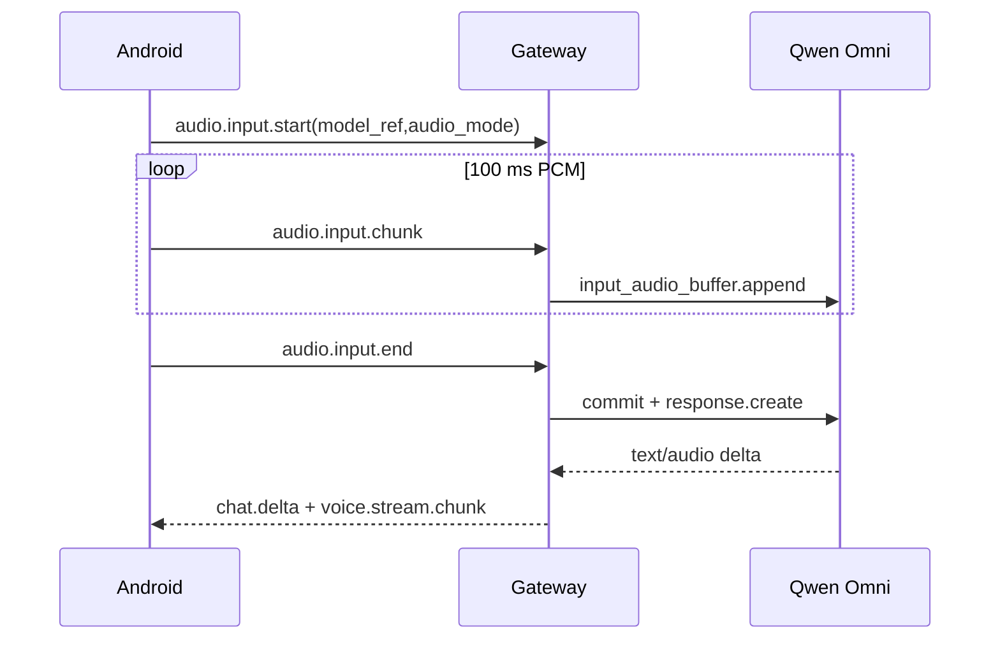

# Omni 音频直通与 Realtime 对话

> 类型: feature
> 状态: active
> 负责人: Codex
> 更新: 2026-10-13
> 关联: apps/gateway/deviceHub/omniAudio.js, apps/gateway/deviceHub/audioInput.js, docs/plans/PLAN-android-companion-contracts.md §C1.7/§C4, docs/testing/TC-voice-provider-config.md

## 1. 概述

选择支持音频的模型后，手机麦克风可绕过独立 ASR，把原始音频交给 Qwen3.8 Omni；Realtime 型号同时把模型返回的文字和 24 kHz PCM 音频流回手机播放。

## 2. 行为说明

模型描述符用 `input/output/transport/audio` 声明能力。手机按所选模型自动选择三种路径：普通文本模型使用已配置 ASR；`audio.mode=direct` 把整段 WAV 作为 `input_audio` 发送并将转录文本交给 Pi；`transport=realtime` 在录音开始时建立 WebSocket，逐块发送 PCM，松手后 commit 并创建响应。Realtime 的文字增量进入 `chat.delta/chat.final`，音频进入 `voice.stream.start/chunk/end`。

手机会保留网关返回的结构化音频错误并显示其中的 `message`（如 `ASR HTTP 401/403/400`），同时写入不含凭据的 Web 日志，避免把错误对象渲染成无法诊断的 `[object Object]`。

## 3. 接口与协议

`audio.input.start` 新增可选 `model_ref` 与 `audio_mode=transcribe|direct|realtime`。电脑端通过 `model.catalog.get` 向手机只返回已启用模型的安全描述符，不返回 key、headers 或 extra_body。Realtime 使用 Model Studio 工作区专属 `/api-ws/v1/realtime?model=...`，16 kHz mono s16le 输入、24 kHz mono s16le 输出。

## 4. 配置项

Qwen 预设包含 `qwen3.8-omni-flash` 与 `qwen3.8-omni-flash-realtime`。Realtime 必须把 provider `base_url` 配为工作区专属 compatible-mode URL，或设置 `realtime_url`。公开 `dashscope.aliyuncs.com` 域名不能用于该 Realtime 型号。

## 5. 限制与已知问题

- 普通 Omni 音频先由同一模型提取用户原话，再进入 Pi 工具循环；Pi 当前消息类型不直接承载 audio part。
- Realtime 模型的原生响应直接回传，当前不桥接 Pi 本地工具调用；键盘文字可通过同一 Realtime WebSocket 对话。
- API Key 必须是允许自定义应用调用的 Model Studio API 凭据，不能使用限制在编程工具内的 Token Plan 专属 Key。

## 6. 测试用例

TC-VOC-024、TC-VOC-025，见 `docs/testing/TC-voice-provider-config.md`；TC-AND-053，见 `docs/testing/TC-android-web.md`。
