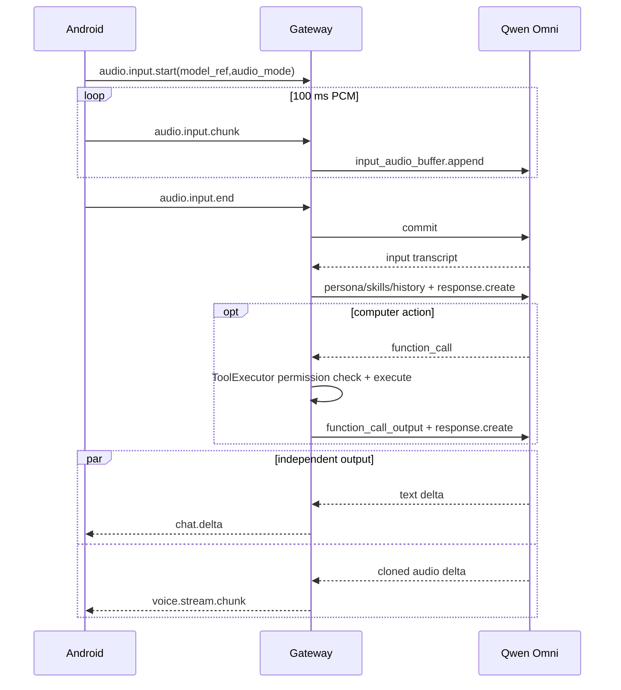

# Omni 音频直通与 Realtime 对话

> 类型: feature
> 状态: active
> 负责人: Codex
> 更新: 2026-10-13
> 关联: apps/gateway/deviceHub/omniAudio.js, apps/gateway/deviceHub/audioInput.js, docs/plans/PLAN-android-companion-contracts.md §C1.7/§C4, docs/testing/TC-voice-provider-config.md

## 1. 概述

选择支持音频的模型后，手机麦克风可绕过独立 ASR，把原始音频交给 Qwen3.8 Omni；Realtime 型号可原生调用电脑工具，并把可见文字和 Yachiyo 复刻音色的 24 kHz PCM 分别流回手机。

## 2. 行为说明

模型描述符用 `input/output/transport/audio` 声明能力。手机按所选模型自动选择三种路径：普通文本模型使用已配置 ASR；`audio.mode=direct` 把整段 WAV 作为 `input_audio` 发送并将转录文本交给 Pi；`transport=realtime` 在录音开始时建立 WebSocket并逐块发送 PCM。松手后网关等待输入转写，用它加载人格、技能和最近会话，再创建响应。

Realtime 会话把本地 `ToolExecutor` 工具注册到 `session.tools`。模型发出 `response.function_call_arguments.done` 后，网关在现有权限和工作区策略下执行工具，发送 `function_call_output`，等同一轮全部工具完成后仅创建一次续答。原生音频、可见文本和工具事件互不替代：音频进入 `voice.stream.start/chunk/end`，文本进入 `chat.delta/chat.final`，工具状态进入 `tool_call.*`。Realtime 会话排除 `voice.tts_aliyun_vc`，避免原生复刻声音与第二套 TTS 同时播放。

录音采用「最新输入优先」：首个 Realtime 录音已 commit 但工具或续答尚未结束时，新的 `audio.input.start` 会取消旧 Realtime 连接并立即开始新 stream。该打断不显示“Audio stream already active”或“Realtime audio cancelled”错误，且旧 stream 的异步收尾不能清掉新 stream。

手机会保留网关返回的结构化音频错误并显示其中的 `message`（如 `ASR HTTP 401/403/400`），同时写入不含凭据的 Web 日志，避免把错误对象渲染成无法诊断的 `[object Object]`。Realtime 配置错误使用 `-32602` 并保留可操作的原因；网关模型目录把缺少工作空间地址的型号标为 `available=false`，手机与桌面聊天会显示但禁用该型号，并自动选中下一个可用模型。

## 3. 接口与协议

`audio.input.start` 新增可选 `model_ref` 与 `audio_mode=transcribe|direct|realtime`。电脑端通过 `model.catalog.get` 向手机只返回已启用模型的安全描述符，不返回 key、headers 或 extra_body；每个模型可带 `available` 与不含凭据的 `reason`。Realtime 使用 Model Studio 工作区专属 `/api-ws/v1/realtime?model=...`，16 kHz mono s16le 输入、24 kHz mono s16le 输出。工具名按 Realtime 限制编码，结果以 JSON 字符串放入 `conversation.item.create.item.output`，`call_id` 与模型请求保持一致。

## 4. 配置项

Qwen 预设包含 `qwen3.8-omni-flash` 与 `qwen3.8-omni-flash-realtime`。Realtime 必须把 provider `base_url` 配为工作区专属 compatible-mode URL，或把 `realtime_url` 配为工作空间专属 `wss://*.maas.aliyuncs.com` 地址。公开 `dashscope.aliyuncs.com` 域名不能用于该 Realtime 型号；配置页会拒绝保存这类组合。可用已登录的阿里云 CLI 安装 `aliyun-cli-modelstudio` 扩展，通过 `modelstudio list-workspaces` 取得当前地域的工作空间 `apiHost`，再拼成 `wss://<apiHost>/api-ws/v1/realtime`。API Key 仍只保存在本机 Provider 配置或环境变量中。

Realtime 原生音频的 `realtime_voice` 预设默认是官方音色 `Tina`，模型条目可显式覆盖。当前用户配置使用通过 `qwen-voice-enrollment` 为目标模型创建的 Yachiyo 音色 `qwen-omni-vc-yachiyo-voice-20261013043837690-9e33`。该值只决定 Realtime 原生音频，不改变普通 Pi 会话的 TTS Provider。

## 5. 限制与已知问题

- 普通 Omni 音频先由同一模型提取用户原话，再进入 Pi 工具循环；Pi 当前消息类型不直接承载 audio part。
- Realtime 语音和桌面键盘会话复用 Pi 所在运行时的 ToolExecutor、人格、技能和会话存储，但模型循环由 Qwen Realtime 的 Function Calling 驱动；其工具规划行为可能与 Pi 不同。
- 手机近场录音会受扬声器、耳机和环境噪声影响；链路成功不等于转写内容准确，声学识别需要用真人近讲和安静环境单独验收。
- API Key 必须是允许自定义应用调用的 Model Studio API 凭据，不能使用限制在编程工具内的 Token Plan 专属 Key。

## 6. 测试用例

TC-VOC-024、TC-VOC-025、TC-VOC-026、TC-VOC-027、TC-VOC-028、TC-VOC-029，见 `docs/testing/TC-voice-provider-config.md`；TC-AND-053，见 `docs/testing/TC-android-web.md`。
