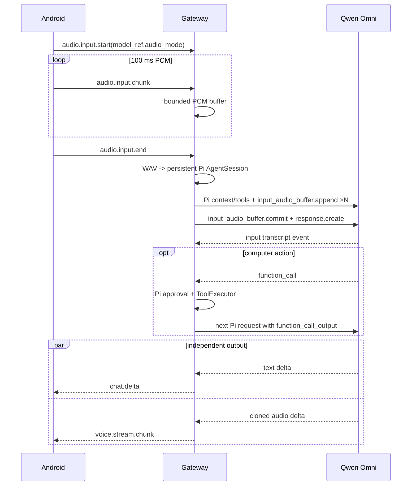

# Omni 音频直通与 Realtime 对话

> 类型: feature
> 状态: active
> 负责人: Codex
> 更新: 2026-10-13
> 关联: apps/gateway/deviceHub/omniAudio.js, apps/gateway/deviceHub/audioInput.js, docs/plans/PLAN-android-companion-contracts.md §C1.7/§C4, docs/testing/TC-voice-provider-config.md

## 1. 概述

选择支持音频的模型后，手机麦克风可绕过独立 ASR，把原始音频交给 Qwen3.8 Omni；Realtime 型号经 Pi 的统一 Agent 循环调用电脑工具，并把可见文字和 Yachiyo 复刻音色的 24 kHz PCM 分别流回手机。

## 2. 行为说明

模型描述符用 `input/output/transport/audio` 声明能力。手机按所选模型自动选择三种路径：普通文本模型使用已配置 ASR；`audio.mode=direct` 把整段 WAV 交给普通 Omni 提取用户原话后进入 Pi；`transport=realtime` 则把录音保存为 16 kHz PCM WAV，并把音频引用直接挂在同一个 `device-<id>` Pi 用户 turn 上。Pi 的 `qwen-realtime` provider 提取原始 PCM，以每块最多 32000 bytes 的 `input_audio_buffer.append` 发送，最后执行一次 `input_audio_buffer.commit`，因此不存在独立 Realtime ASR 请求，也不会用一次转写请求再触发第二次回答请求；长录音也不会形成超过 256 KiB 的单个 WebSocket JSON 帧。

`qwen-realtime` provider adapter 把 Pi transcript、当前工具声明和 system sections 转成 Realtime 原生事件；模型的 function call 转回 Pi 标准 `toolCall`。因此工具并行、审批、steering/follow-up、错误预算、会话 JSONL 和上下文压缩都由 Pi 处理，adapter 不直接调用 `ToolExecutor`。模型请求工具后，adapter 暂存当前 WebSocket；Pi 执行工具，并在同一条云端连接上追加匹配 `call_id` 的 `function_call_output` 后触发续答。这样 Qwen 仍持有服务端 function call，不会因跨连接续接而拒绝工具结果。连接结束后的旧工具调用与结果仍从 Pi transcript 恢复，但会转成带标签的文字历史，避免把只在旧连接有效的 `call_id` 重放到新连接。原生音频、可见文本和工具事件互不替代：音频进入 `voice.stream.start/chunk/end`，显式文字由 `ui.chat.post` 进入两端消息框，未调用该工具时 final 由 `chat.final` 回退显示，工具状态进入 `tool_call.*`。启用原生音频时 adapter 隐藏 `voice.tts_aliyun_vc` 并追加禁止二次 TTS 的 provider 指令，避免同时播放两套声音。模型自行决定是否说话；调用 `ui.chat.post` 后的工具续轮只请求文字，内部确认不播放也不重复显示。

录音采用「最新输入优先」：录音结束后采集层立即把 WAV 移交给 RuntimeRpcWorker，不等待云端转写。新的录音可以马上开始；如果同一 Pi 会话仍在生成、等待审批、执行工具或续答，worker 调用 Pi 原生 `abort()`，把 run 的 `AbortSignal` 传到工具桥，等待旧请求以 `ABORTED` 收口后再把新音频送入原有 `AgentSession`。尚未进入 Pi 的旧请求也会被新语音淘汰。普通文字纠正仍可显式使用 Pi `steer`，在当前工具完成后改方向。

手机会保留网关返回的结构化音频错误并显示其中的 `message`（如 `ASR HTTP 401/403/400`），同时写入不含凭据的 Web 日志，避免把错误对象渲染成无法诊断的 `[object Object]`。Realtime 配置错误使用 `-32602` 并保留可操作的原因；网关模型目录把缺少工作空间地址的型号标为 `available=false`，手机与桌面聊天会显示但禁用该型号，并自动选中下一个可用模型。

## 3. 接口与协议

`audio.input.start` 新增可选 `model_ref` 与 `audio_mode=transcribe|direct|realtime`。电脑端通过 `model.catalog.get` 向手机只返回已启用模型的安全描述符，不返回 key、headers 或 extra_body；每个模型可带 `available` 与不含凭据的 `reason`。Realtime 使用 Model Studio 工作区专属 `/api-ws/v1/realtime?model=...`，16 kHz mono s16le 输入、24 kHz mono s16le 输出。采集层只落盘受限 WAV；唯一模型连接由 Pi provider adapter 管理。用户转写通过 `audio.input.transcript` 定向回原设备；工具名沿用 Pi 的安全编码，`call_id` 在 Pi tool call 与下一次 `function_call_output` 间保持一致。

## 4. 配置项

Qwen 预设包含 `qwen3.8-omni-flash` 与 `qwen3.8-omni-flash-realtime`。Realtime 必须把 provider `base_url` 配为工作区专属 compatible-mode URL，或把 `realtime_url` 配为工作空间专属 `wss://*.maas.aliyuncs.com` 地址。公开 `dashscope.aliyuncs.com` 域名不能用于该 Realtime 型号；配置页会拒绝保存这类组合。可用已登录的阿里云 CLI 安装 `aliyun-cli-modelstudio` 扩展，通过 `modelstudio list-workspaces` 取得当前地域的工作空间 `apiHost`，再拼成 `wss://<apiHost>/api-ws/v1/realtime`。API Key 仍只保存在本机 Provider 配置或环境变量中。

Realtime 原生音频的 `realtime_voice` 预设默认是官方音色 `Tina`，模型条目可显式覆盖。当前用户配置使用通过 `qwen-voice-enrollment` 为目标模型创建的 Yachiyo 音色 `qwen-omni-vc-yachiyo-voice-20261013043837690-9e33`。该值只决定 Realtime 原生音频，不改变普通 Pi 会话的 TTS Provider。

## 5. 限制与已知问题

- 普通 Omni 音频先由同一模型提取用户原话，再进入 Pi 工具循环；Pi 当前消息类型不直接承载 audio part。
- Realtime 工具续答连接最多等待 55 秒；若人工审批超过云端会话的空闲窗口，本轮会以连接失效错误结束，用户可重新发起请求。
- 手机近场录音会受扬声器、耳机和环境噪声影响；链路成功不等于转写内容准确，声学识别需要用真人近讲和安静环境单独验收。
- API Key 必须是允许自定义应用调用的 Model Studio API 凭据，不能使用限制在编程工具内的 Token Plan 专属 Key。

## 6. 测试用例

TC-VOC-024、TC-VOC-025、TC-VOC-026、TC-VOC-027、TC-VOC-028、TC-VOC-029、TC-VOC-030、TC-VOC-038，见 `docs/testing/TC-voice-provider-config.md`；TC-PI-038…047 见 `docs/testing/TC-runtime-pi-agent-core.md`；TC-AND-053 见 `docs/testing/TC-android-web.md`。
