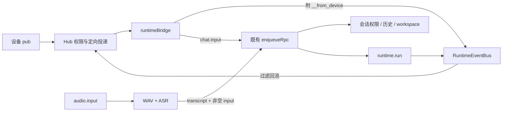

# Device Hub 模块参考

> 类型: module
> 状态: active
> 负责人: codex (gpt-6-astra)
> 更新: 2026-10-12
> 关联: ../../plans/PLAN-android-companion-contracts.md, ../../features/FEAT-device-hub-bus.md, ../../features/FEAT-device-hub-avatar-transfer.md, ../../features/FEAT-plugin-push.md, ../../../apps/gateway/deviceHub/

## 装配与生命周期

`apps/gateway/server.js` 只把原 `/ws` WebSocketServer 改为 `noServer`，在附近调用：

```js
require('./deviceHub').attachDeviceHub({
  server, app, wss, bus,
  enqueueRun: enqueueRpc,
  executor, sessionStore
});
```

`attachDeviceHub` 创建 Hub，装配 avatar、HTTP、runtime bridge、语音、ASR 与插件存储，并在唯一 upgrade listener 中分发 `/ws` 和 `/ws/device`。HTTP 服务器关闭时清理 WS、心跳、在途请求、桥接订阅与语音/录音计时器，恢复空实现。不得再为相同 server 创建带 `path` 的独立 WS upgrade listener。

测试通过 `config`、`avatar`、`voice`、`audio`、`plugins` 参数注入固定 token、短超时、临时目录和 mock 服务；不依赖云端、真实 LLM 或 Android。

## 文件职责

| 文件 | 职责 |
|---|---|
| `index.js` | get/setDeviceHub、NullDeviceHub、唯一装配入口 |
| `config.js` | 只在缺 token 时生成配置，常量时间 token 比较 |
| `accessControl.js` | loopback 判定、远程管理/API/runtime WS pairing 鉴权、appassets CORS |
| `hub.js` / `topics.js` | v1 帧、设备 registry、订阅/投递、双向 RPC、工具发现、权限 |
| `runtimeBridge.js` | runtime/设备发布桥接，聊天映射、工具任务聚合、设备输入入队 |
| `avatarHost.js` | 原子持久化、prepare/exit/enter 时序、取消与回滚 |
| `voiceRelay.js` | Qwen 非流式 TTS、媒体下载 URL、TTL、旧 host 结果丢弃 |
| `audioInput.js` | PCM 协议/序列校验、WAV、录音取消、ASR 后输入 |
| `asrService.js` | 只读 Model Catalog、OpenAI multipart、Qwen ASR、工具回退 |
| `pluginArchive.js` | ZIP store/deflate 编解码、CRC32、路径/资源上限与 manifest 校验 |
| `pluginStore.js` | SHA-256 存储、push URL、锁屏过滤、回执缓存 |
| `httpRoutes.js` | localhost/token 权限以及 C1.8 HTTP 接口；全局管理鉴权在 server 装配 accessControl |

## 服务端 API

```js
const { getDeviceHub } = require('./deviceHub');
const hub = getDeviceHub();
hub.enabled;
hub.getAvatarHost();
hub.listDevices();
hub.listToolMethods();
await hub.invoke(deviceId, method, params, { timeoutMs: 8000 });
await hub.requestAvatarTransfer(to, { reason: 'user-request' });
hub.publish(topic, data, { target: deviceId });
hub.on('tools.changed', refreshTools);
hub.on('devices.changed', refreshDevices);
hub.on('avatar.host.changed', ({ host, prev, transfer_id }) => {});
```

- `listDevices()` 包含 device_id/device_type/name/mode/alias/capabilities，不暴露 socket、方法 registry 或 token。alias 来自 hello 可选 alias，否则回退 name/id；客户端显式 alias 尚需跨工作流统一。
- `invoke('avatar-host', …)` 解析当前 host，若为 desktop 按新 C5 抛 -32010，由调用方走原 17373 路径。具体 device_id 允许 Hub RPC；未注册的 Live2D C1.6 方法仍可调用。
- 工具名以 alias 开头并替换方法名中的点；别名冲突加设备 ID 散列后缀，方法变化/离线/锁屏触发 tools.changed。锁屏时撤下插件工具并取消在途插件调用。
- `requestAvatarTransfer` 的 Promise 在完成/失败时均 resolve `{transfer_id,host,status,reason?}`。reason 当前仅为调用方上下文，不改变 C1.5 时序。内部 `transferAvatar({to})` 在失败时 reject，供 HTTP 和设备 RPC 使用。
- `publish` 默认按订阅投递；内部仅在握手状态、移交、媒体、转录、安装这类定向控制路径使用 `direct: true`。即使 direct 也遵守 host/锁屏规则。
- 空实现 `enabled=false`，设备/工具为空；invoke 抛 -32010；requestAvatarTransfer 返回 failed。

## 事件与输入路径



所有 chat.input 使用 `device-<device_id>`，不接受设备覆盖其他会话的 ID。既有网关的会话权限默认值继续生效，ASR 工具回退显式读取设备会话权限、缺省 low。

桥接支持新 `message.delta` / `runtime.final`、旧 `runtime.event` 的 llm.stream.delta/llm.final/done，以及 tool_call.* / tool.call.*。事件按 session/trace/seq 去重，最终回复再按 session/trace 去重；任务缓存上限 128，事件去重窗口上限 2048。

C1.7 的 `transcribed_text`、confidence 与 segments 会通过 server/worker 规范化；预填转录跳过重复 ASR。带非空 input 的请求仍把音频对象注入 runtime context，会话历史保存 audio_ref/format/lang/transcribed_text/confidence。

## 文件与配置

路径以 `YACHIYO_HOME`（缺省 `~/yachiyo`）为根：

| 路径 | 内容与保留策略 |
|---|---|
| `config/device-hub.yaml` | pairing_token（24 随机字节，hex）；heartbeat_ms 默认 15000、最小 100；首次写权限 0600 |
| `data/device-hub/state.json` | avatar_host，临时文件 + rename 原子替换 |
| `data/device-media/*.audio` | TTS 媒体；10 分钟 TTL，单条 20 MiB；定时/访问时清理 |
| `data/device-audio/<stream_id>.wav` | 设备录音，独占创建不覆盖；为会话保留，运维清理 |
| `data/device-plugins/<sha256>.yplug` | 已验证插件，重启索引，无自动删除 |

TTS 沿用 `QwenTtsClient` 的 qwen3_tts provider。ASR 读取 C4 Catalog 的 asr provider；为了在 WS2 合并前可读 asr 类型，以无写入的原 YAML store 调用 Catalog。DashScope 支持 Qwen 的短音频非实时 ASR（inline WAV），不实现 Paraformer URL 异步任务队列。

## 桌面与设备页

桌面使用 `main/deviceHubClient.js`，经本机 pairing 或 `DEVICE_HUB_TOKEN` 授权。渲染器通过现有 IpcRpcBridge 的内部 `avatar.hub.event` 方法处理 welcome/移交，`renderer/avatarTransfer.js` 只控制模型可见性与 canvas 位移。失去 host/连接后阻断语音；旧 `/ws` 继续负责桌面聊天和 TTS 请求，人物动作改经 Hub，避免双重动作。

`/devices.html` 是无外部资源依赖的中文设备页。为了不修改其他工作流页面，本次没有给旧首页增加导航项，直接打开该 URL。页面提供 URL + token 配对形式（施工文档允许），不生成二维码。

## 边界与验证

单桌面假设；旧桌面未升级为 Hub 客户端时不能参与移交。网关保留离线 host，不自动抢回；状态 JSON 损坏需运维修复。默认局域网 HTTP/WS，跨公网使用需要部署层 TLS。插件细粒度权限与安装由 Android 宿主负责。

```sh
node --test test/gateway/deviceHub/*.test.js
npm run test:ci
npm run docs:index
```

参见 [TC-device-hub-bus.md](../../testing/TC-device-hub-bus.md) 与 [TC-device-hub-avatar-transfer.md](../../testing/TC-device-hub-avatar-transfer.md)。桌面动画、真实音频与 Android 安装由统筹者执行跨端人工验收。
