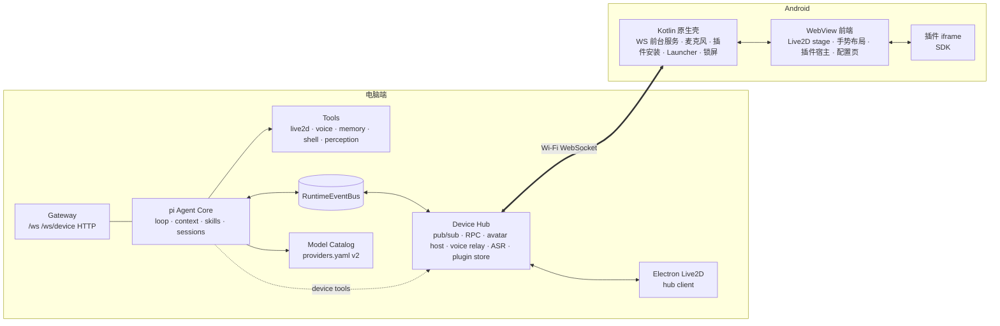
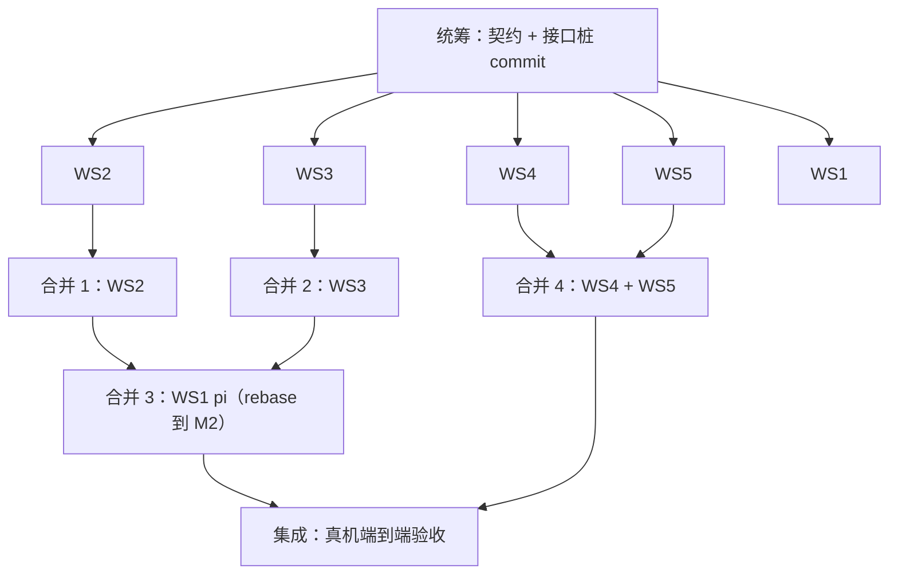

# Yachiyo Android Companion + pi Agent Core 总体施工计划

> 类型: plan
> 状态: active
> 负责人: codex-coordinator
> 更新: 2026-10-13
> 关联: PLAN-android-companion-contracts.md, EXP-20261012-android-live2d-webview-feasibility.md, 各 PLAN-android-ws*.md

## 当前集成状态（2026-10-13）

- Desktop D1 外壳、标准聊天窗及紧凑布局打磨已完成代码集成；macOS 最终人工视觉验收仍需统筹者执行。
- Android B1/B6/B8/B9、统一主题、迁移 HUD 与完整模型 bounds 几何约束已完成代码和自动化整合；最终 bounds 仍需小米 6 真机视觉复核。本次最终集成不安装 APK、不触发 transfer。
- ChatGPT plan 后端（OAuth/OIDC、凭据存储、账户模型目录、统一模型选择、Responses 适配）已合入；Desktop Continue with ChatGPT UI、真实账户 OAuth 与真实 Responses 调用尚未验收。
- A15 / 60 FPS 已按用户决定放弃，不再列为阻塞或恢复项。B3 身体抽动已有逐帧修复证据；Worker/VBO/physics/mask 等历史失败性能候选保持未合入。
- 仍需完成的产品验收只包括上述 macOS 视觉、Android 最终 bounds 真机视觉，以及 ChatGPT UI/真实账号链路；不得把 mock 自动化结果表述为真实 OAuth/API 通过。
- 当前集成在隔离 `HOME/TMPDIR` 下通过 Node 789/789 与文档 lint；JDK 17 Android 单测和 debug APK 构建通过（41 tasks）。

## 1. 目标

1. 把 Live2D 桌宠移植到 Android（WebView 渲染，见实验文档结论）。
2. Agent 仍运行在电脑端；手机通过 Wi-Fi 与电脑端网关保持 WebSocket 长连接，在其上实现 **Device Hub 事件总线**（topic 发布/订阅 + 双向 RPC）。
3. Yachiyo 可以在电脑与手机之间**移交**：从一台设备屏幕下方离开，再从另一台设备下方出现。
4. 手机端：音频播放（TTS）、麦克风输入；竖屏全身 + 可自定义背景；横屏聚焦上半身，左滑露出插件入口，右滑露出桌面组件；动效丝滑。
5. 插件系统：JS + HTML5 小程序（横屏打开）与桌面组件，统一 `.yplug` 包格式，手机可直接导入，电脑端可推送；插件可访问事件总线并注册接口（可暴露为 agent 工具）。
6. 手机统一配置界面：服务端地址、背景、任务画布位置、插件导入、默认桌面接管、锁屏显示人物（锁屏下 agent 可控制人物、麦克风与音频，但不能访问插件）。
7. 模型配置升级：支持 DeepSeek 等多种 API、多模型选择、按用途分配、失败回退；配置与凭据只在电脑端管理，手机保持纯客户端职责。
8. **Agent 核心迁移到 pi**（`@earendil-works/pi-coding-agent`）：循环、上下文管理、技能、会话都由 pi 承担；现有工具、事件总线、设备 RPC、音频功能注册为 pi 工具；现有 prompt 迁移到 pi。

## 2. 架构总览

## 3. 工作流划分

| 工作流 | 执行者 | 分支 / worktree | 负责路径 | 施工文档 |
|---|---|---|---|---|
| WS1 Agent 核心迁移到 pi | Codex（gpt-6-astra，high，priority） | `agent/ws1-pi-core` | `apps/runtime/agent-pi/**`，`apps/gateway/server.js` 中 agent 装配段，`test/runtime/agent-pi/**`，`package.json` 依赖 | PLAN-android-ws1-pi-core.md |
| WS2 模型配置 v2 | Sonnet 5.5（medium） | `agent/ws2-llm-models` | `apps/runtime/config/**`，`apps/runtime/llm/**`，`apps/gateway/routes/modelConfig.js`，`apps/gateway/public/config-v2*`，`test/runtime/config/**` | PLAN-android-ws2-llm-models.md |
| WS3 Device Hub + 桌面移交 | Codex（gpt-6-astra，high，priority） | `agent/ws3-device-hub` | `apps/gateway/deviceHub/**`，`apps/desktop-live2d/**`，`apps/runtime/tooling/adapters/live2d.js`（路由），`scripts/plugin-*.js`，`test/gateway/deviceHub/**` | PLAN-android-ws3-device-hub.md |
| WS4 Android 原生壳 | Sonnet 5.5（medium） | `agent/ws4-android-native` | `apps/android/**`（`app/src/main/assets/web/` 与 `sample-plugins/` 除外） | PLAN-android-ws4-android-native.md |
| WS5 Android Web 前端 + 插件 SDK | Sonnet 5.5（medium） | `agent/ws5-android-web` | `apps/android/app/src/main/assets/web/**`，`apps/android/sample-plugins/**`，`scripts/android-sync-assets.js` | PLAN-android-ws5-web-ui.md |
| 统筹 | Claude（本会话） | `feature/android-companion` | 契约文档、合并、集成测试、真机验收 | 本文件 |

每个工作流在独立 git worktree 中开发（`../yachiyo-wt/<ws>`），只修改负责路径。共享文件（`apps/gateway/server.js`、`package.json`）的修改必须**局部、最小**（单独的装配函数 + 一两行挂载），以降低合并冲突。

## 4. 依赖与合并顺序

- 统筹者先提交接口桩：`apps/runtime/config/modelCatalog.js`（v1 兼容的最小实现）与 `apps/gateway/deviceHub/index.js`（空实现），使 WS1 可以在 WS2/WS3 完成前按契约编码。
- WS4 与 WS5 并行：WS5 用 `js/mockNative.js` 在桌面浏览器 / 真机浏览器中开发调试，合并后由统筹者联调。

## 5. 验收标准（统筹者执行）

| 编号 | 验收项 | 方式 |
|---|---|---|
| A1 | `npm run test:ci` 全部通过（基线 507 + 新增） | 自动 |
| A2 | `./gradlew :app:testDebugUnitTest :app:assembleDebug` 通过 | 自动 |
| A3 | 小米 6 安装 APK，竖屏全身显示，背景可自定义 | 真机 |
| A4 | 手机连接电脑网关；电脑端 agent 的 live2d 工具驱动手机上的人物 | 真机 |
| A5 | 移交动画：电脑 ↔ 手机往返各一次，非 host 端不显示人物、不发声 | 真机 + 桌面 |
| A6 | 手机播放 TTS 并口型同步；按住说话 → 识别 → agent 回复 | 真机 |
| A7 | 横屏聚焦上半身；左滑插件入口、右滑组件区，动画连续无跳变 | 真机 |
| A8 | 导入示例插件（app + widget）；插件经事件总线与电脑端通信并注册工具，agent 能调用 | 真机 |
| A9 | 电脑端推送插件到手机并自动安装 | 真机 |
| A10 | 设为默认桌面；锁屏显示人物，锁屏下 agent 可控制人物/语音，插件不可用 | 真机 |
| A11 | DeepSeek 等 provider 配置、多模型选择、回退生效；电脑配置页/桌面聊天窗可切换，手机不暴露模型或 Provider 配置 | 自动 + 手工 |
| A12 | `AGENT_CORE=pi` 下全部原有 e2e 测试通过；`AGENT_CORE=legacy` 可回滚 | 自动 |
| A13 | 每个功能均有 `FEAT-*` 文档与 `TC-*` 用例，`docs/README.md` 索引更新 | 审查 |
| A14 | 配置页自动发现同一局域网服务端，选择端点并配对 | 真机 |
| A15 | 小米 6 连续人物动画及滑动达到 60 FPS 目标，报告真实帧间隔和画质 | 真机性能采样 |
| A16 | 手机使用已选官网宫殿夜景（通过系统选图导入私有目录，离线可用），Android 面板/设置与桌面聊天/控制浮层视觉统一；桌面可真实选择模型并拉取 Provider 模型列表 | 自动 + 真机/桌面截图 |

## 6. 统筹待办

- [x] **网关局域网加固**（WS3 合并后，统筹执行）：网关监听 `0.0.0.0`，`/api/config/*`、`/api/sessions*`、`/api/memory*` 等管理接口目前对局域网无鉴权，且既有 `GET /api/config/providers/config` 会返回内联 api_key。方案：非 loopback 请求必须携带 Device Hub `pairing_token`；`/api/config/providers/config` 与 `/raw` 对外脱敏。
- [x] **WS3 合并审查必查**：设备 `pub` 不得发布网关保留主题（`plugin.install`、`avatar.host.changed`、`avatar.transfer.*`（除 ready/exited/entered）、`sys.device.online/offline`、`voice.play`、`chat.delta/final`、`task.update`）。`/api/device/*` 保留精确 Android appassets CORS；模型与 ChatGPT 管理接口改为仅电脑 loopback 使用，不再向 Android 暴露。
- [x] **工具名线上编码（阻塞多 provider）**：`config/tools.yaml` 工具名含 `.`（如 `live2d.motion.play`），OpenAI/Anthropic/DeepSeek 要求 `^[a-zA-Z0-9_-]{1,64}$`。在 `apps/runtime/agent-pi/toolBridge.js` 中把名称编码为线上名（`.`→`__`），执行时映射回原名；`piRuntime.js` 中 `toolName.startsWith('live2d.')` 等判断与 eventBridge 发出的 `tool_call.*` 事件需使用原名；补测试。
- [x] WS1 遗留：`attachModelContext` 与 WS2 的 worker `model_ref` 透传重复，可删除。
- [x] 合并时统一重新生成 `package-lock.json`（WS1 合并时已 `npm i`）（WS1 新增 pi 依赖）。

## 7. 进度

| 工作流 | 状态 | 最新提交 | 备注 |
|---|---|---|---|
| 统筹：文档整理 + AGENT.md | done | 608edd7 | |
| 统筹：实验 + 契约 + 施工文档 + 接口桩 | done | 0c2b84b | |
| WS1 | merged | 7d4419a | 合并后 564 测试通过；待办：工具名线上编码 |
| WS2 | merged | 63504a1 | 统筹审查修复：/test 凭据外泄（63504a1）；538 测试通过 |
| WS3 | merged / integration | 84c2924 | 设备总线已合并，继续鉴权、发现广播和跨端联调 |
| WS4 | merged | c039c32 | 修复后合并：Bridge 令牌门控（391ab63）、插件推送仅信任网关且 token 不外发；Gradle 单测 + APK 构建通过 |
| WS5 | merged / integration | 0eaf75c | Web 前端已合并，继续自动发现配置与真机联调 |

## 8. Codex 接续验收（2026-10-12）

- 已保留旧 worktree 与未提交契约修改，新增三个独立 `agent/*` worktree；子 agent 统一 GPT-5.6 Sol / high，统筹负责合并验收。
- WS3 合并后 Node 588/588；WS5 合并后隔离测试环境 Node 624/624。首次 WS5 回归出现 legacy 子进程启动 7 秒超时，隔离后全量通过，继续观察。
- 集成 Android 已同步模型资源，JDK17 单测与 assembleDebug 通过。
- 用户新增目标 A14：配置页自动发现同一局域网的服务端、选择地址并配对；接口见 C7，广播不暴露令牌。
- 新分工：`ws1-pi-completion` 负责工具名兼容与 pi 补查；`ws3-integration` 负责网关通信边界、音频元数据与发现广播；`android-integration` 负责 Android 联调与发现 UI。
- 真机初验等待现有 WS5 设备锁释放，不抢占正在使用的设备。

### 集成批次 2

- 汇合 pi `74992fc`、Hub `2cb9de1/4e1c504/d553318/400969a/e976ec3`、Android `9fd91be/69d7e7e/e3e915e/4d99a7b`，同步依赖锁文件。
- 全量 Node 642/642 通过，Android 单测/assembleDebug 通过；新增完整 pi → Hub → 手机插件 RPC 离线 e2e 通过。
- 真机竖横屏、两侧面板、插件推送/安装和 start_timer RPC 已通过，详见集成实验与 TC-COMP。
- 新增用户目标 A15：小米 6 60 FPS。初始横屏仅20.34 FPS；耗时主要在 Cubism 求值，正在性能专项优化，不标记验收完成。

### 集成批次 3（2026-10-13）

- `c524618` 修复带在线 WebSocket 的网关退出及广播失败降级，Node 644/644。
- `38cbb2a` 修复 Android 模型响应包装造成设置渲染中断，以及锁屏覆盖页无法退出；Node 646/646、Android 单测和构建通过。
- 原真实模型配置复制到权限受限的隔离目录，pi 联网调用 Qwen 返回“模型连接正常”，约 1999 ms；未更改用户原运行目录。
- 真实 Electron 渲染器已显示移交人物；双向 transfer API 均成功。手机返回截图因休眠全黑，待唤醒后的视觉确认，不把 API 成功替代画面验收。
- NSD 已在小米 6 发现真实广播名称/IP/3002 端口；候选点击流程在设置修复后复验。
- 默认 Launcher 已实际切换并恢复；锁屏无插件、单次 RPC 路由、插件拒绝已验证，退出修复待复验。
- TTS/ASR 真实服务验证通过，手机播放、口型、录音仍需独立设备验收。
- 性能继续作为阻塞项：基线瓶颈为 Cubism core 与物理求值，Worker 优化版正在独占设备复测。

### 2026-10-13 后续修复与用户反馈

- `c96dc4b`：稳定基线音频HAL兼容修复；Node653/653、Android通过；真机TTS播放2407ms和口型变化通过。
- 用户反馈实验版人物抽动，已撤回手机上的性能实验APK；主线尚未包含Worker/physics节流/渲染器实验。手机保持稳定版（含音频修复）。
- A15仍未达标；后续性能候选必须同时通过动作连续性、口型、绘制次数和帧率验证。
- 真实API后续遇到阿里云Arrearage；不再重试或修改用户账单。麦克风采集已验证，完整实录ASR→回复仍未完成。
- 用户新增背景选择需求：为八千代寻找更贴合影片月读虚拟空间、适合人物叠加的背景。

- 隔离性能候选 `827f036` 真实 draw 达竖屏55.59FPS、横屏连续滑动54.27FPS，Worker18Hz左右并插值；目标仍未通过。测试后恢复含音频修复的稳定 APK，继续优化绘制状态调用。
- 背景已向用户展示官网水上宫殿夜景原图，尚未替换手机配置。

- 主线合入麦克风流隔离 `0da92cf` / 畸形帧保护 `f7b0dd7`，Node658/658通过。
- 用户购买通用节省计划后授权复测，最小模型请求HTTP200/1363ms、pi到手机TTS播放2325ms成功；空实录ASR仍待调查。
- FPS计时已发现host/CDP采样边界偏差，后续只用页面时钟。02cf3f6暖机真实draw55.96FPS，继续交错VBO优化；候选未合并，手机保持稳定版。

### UI 刷新工作流（2026-10-13）

- 统筹决策：采用官网 `character_bg.jpg` 宫殿夜景；素材不复制进仓库或默认发布包，真机通过现有系统选图 → `NativeFeatures` 私有目录导入，以保证离线持久化。设置页保留带来源链接的网络预设，加载失败时以 `#090b20` 回退色显示。
- Android `08f3198`：主舞台、HUD、横屏面板、抽屉和设置页统一深蓝紫夜景、暖金/淡紫强调色。侧面板使用内部静态高斯预模糊装饰层，不对 Live2D 使用大型 `backdrop-filter`，因此不新增每帧人物离屏滤镜；未修改 `stage.js`、Live2D core、渲染优化器或人物动作逻辑。
- Desktop：透明人物窗口保持透明；聊天、气泡、布局/口型/拖拽区浮层统一夜景视觉。聊天窗模型选择经 main process 精确 allowlist 调用现有 `GET /api/config/models`、`PUT /api/config/models/selection`、`POST /api/config/models/discover`；请求体按操作投影，成功响应再次投影掉 `headers`、`extra_body`、`base_url`、`api_key_env` 等配置字段，错误和网络异常统一脱敏，renderer 不接收 token/API key。
- 自动验证：候选分支 Node `npm run test:ci` 664/664；独立审查修复后隔离 `HOME`/`TMPDIR` 全量 Node 665/665。Android JDK17 `:app:testDebugUnitTest :app:assembleDebug` 通过。
- 尚待验收：手机因电量耗尽关机，重启后由性能验收工作流安装 `1169fd3` 构建的最终 UI APK，确认设置页职责边界、背景持久化并恢复临时旋转设置。Desktop 启动、模型保存重开及成功/空/离线状态已完成。
- 真机已通过系统 DocumentsUI 把官网 2400×1440 夜景复制到应用私有 `files/user/backgrounds/`；强停重启后背景保持。竖屏人物、横屏插件抽屉与设置页截图已留存；背景素材未进入发布包。
- 用户明确手机是客户端：Android 已移除模型目录拉取、模型选择、Provider 与 Provider API key UI/调用。桌面继续提供模型选择和 Provider 列表拉取；ChatGPT 登录与模型资料也只在电脑端。
- 本轮原候选提交顺序为 Android `08f3198`、Desktop `2958a90`、手机客户端职责调整 `1169fd3`、Desktop 首启竞态修复 `05eebd3`、验收记录 `7e99c43`；独立审查分支对应提交为 `74aae6e`、`03c1828`、`4c2401e`、`6150bf6`、`d367287`。审查发现并以 `8ad8b31` 修复 Desktop 模型 IPC 成功响应可暴露 Provider headers/extra_body 等字段的问题；音频证据与实时 TTS checkpoint `251b1b2` 对应集成提交为 `f344cc2`。
- 性能候选 `48a574b` 在关机前采到 idle 54.12 FPS、swipe 52.18 FPS，A15 未达标。该样本临近用户确认的电量耗尽，只能说明本次验收未达到 60 FPS，不能单独用于判定交错 VBO 优化发生性能回退；人物抽动仍需最终融合包独立复验。
- Desktop Electron 已连接隔离网关 `127.0.0.1:3002` 实测：首次打开直接加载 2 个模型/4 个 Provider；对当前模型执行保存后刷新 renderer，仍恢复同一 active ref。模型浮层截图为 `/tmp/ui-refresh-desktop-chat-models.png`。状态化本地网关自动覆盖 discover 成功、空列表、服务离线与保存后重开。实测同时发现并修复了 chat renderer 早于模型 IPC 注册的首次启动竞态。

### UI 独立审查与主线集成（2026-10-13）

- 代码与截图审查通过：Android 无模型、Provider 或 API key 入口；官网背景保留来源链接，系统选图会复制到 App 私有目录并由配置保存；横屏侧面板只模糊自己的静态伪元素，不对 Live2D 每帧做大面积 `backdrop-filter`；Desktop 首启 IPC 注册顺序、成功/空/离线及保存重开路径均有证据。
- Desktop IPC 原候选只限制 method/path，但网关成功快照仍含 Provider `headers`、`extra_body`、`base_url`、`api_key_env`。审查修复后，选择请求仅允许 `active_model`/`enabled_models`，发现请求仅允许 Provider key；返回只保留模型展示字段和 Provider key/display name/凭据存在性布尔值。
- UI 与音频文档批次已通过独立工作树验证，允许合入 `feature/android-companion`；最终手机安装、背景重启持久化和竖横屏观感仍由设备验收工作流通过 USB 执行，不能用历史截图替代本轮验收。
- A15 仍未通过：最终 UI 包此前采样未达到 60 FPS，人物抽动也没有验收通过。用户最新报告空闲时人物持续张嘴且嘴形异常；最终 UI 包已复现静音后 `mouth form` 残留，此问题由独立口型修复工作流处理，未把任何 Worker/VBO/physics 候选并入本批次。
- ChatGPT 认证/模型资料工作仍在独立计划分支，尚未审查合并。实时 TTS 仅完成设计 checkpoint；物理扬声器在系统音量 17/25、应用音量 1 下由用户确认正常，真实讲话 ASR→pi 回复仍未完成。

### 静音口型修复与桌面恢复（2026-10-13）

- 独立审查后把口型修复 `ecdfb6b` 映射为主线 `59a805d`，验收文档 `57d6cd4` 映射为 `000c504`。修复在 Cubism 的真实 `beforeModelUpdate` 中持续恢复 MOC 口型默认值，同时保留 action/RPC overlay 与活跃语音的更高优先级；release 同帧把 stage 的 open/form/active 归零。
- 小米 6 USB 真机子集通过：静音 Idle 15 秒 466 次真实更新全为 0/0；本地参考音频播放中口型自然变化；结束后 3 秒 94 次真实更新全为 0/0。Greet/ReactError 和显式 overlay 尚未单独真机操作，由资源审计与自动化覆盖。合并后隔离 Node 667/667、Android JDK17 单测与 Debug APK 构建均通过。
- 用户反馈电脑端不可见时，隔离 gateway `127.0.0.1:3002` 与 Electron 均在运行，实际原因是 `avatar_host` 仍为 Android。手机验收释放设备后，正常 `avatar.transfer` 已切回 `desktop`；CUA 分别确认角色窗口和聊天主界面实际可见。主界面常驻双向迁移按钮由独立 UI 工作流实现，复用现有 transfer/owner/pending 状态。
- A15 仍未通过，身体抽动也未验收通过。本轮口型结论不能替代 60 FPS、连续身体动画或性能候选验收；设备当时温度 46°C、电量 27%，不用于性能基准。
- ChatGPT 认证候选的独立审查发现 ID token 经 authorization URL 泄漏、loopback 写 API CSRF/DNS rebinding、并发 start listener 泄漏和 OIDC `azp` 缺失；修复候选仍在复审，未合入主线。实时 TTS 与真实讲话 ASR→pi 回复仍在进行。

### 用户停止 checkpoint（2026-10-13）

- 用户要求立即停止开发并保留完整交接；主线停在 `d2d606b`，没有继续合入 Android presence、Desktop native shell、配置 WebUI 或 ChatGPT OAuth 候选。
- 手机“角色突然出现后消失”的根因已定位为 Android 旧 `isHost()` 在 Device Hub 断线/owner 未知时默认返回 true，重连收到权威 `avatar_host=desktop` 后再隐藏。独立修复 `d3d526a` 已保存且聚焦测试 3/3 通过，但未合主、未构建 Android、未装机；完整 Desktop/Android 迁移控件仅以未审查 WIP `5d59805` 保存。
- 配置 WebUI 重构仅完成只读盘点与方案文档 `5db6a91`，产品代码未开始。当前 `/api/config/models` 仍会返回 Provider `headers`/`extra_body`，且整个 `/api/config/**` 尚未实施真实 socket loopback-only 门禁；恢复工作时先修安全边界。
- ChatGPT OAuth/Responses 候选链 `111c933` → `5b8f67f` → `f99f2d2` → `95260ee` 已完成代码与修复候选审查，但未合主、未做真实 OAuth/API；恢复时必须在当前主线重放并处理文档/配置 UI 冲突后再跑隔离全量测试。
- 详细分支、测试、运行态、设备状态和下一步见 [HANDOFF-20261013-companion.md](../process/HANDOFF-20261013-companion.md)。A15 仍为 55.96 FPS、未到 60；身体抽动未通过。共享 mask 局部 dirty 候选 `7ff5774` 因会清空共享 FBO 后漏画未变化 source，已由 `bb4a197` 撤销，未安装、未合主。
