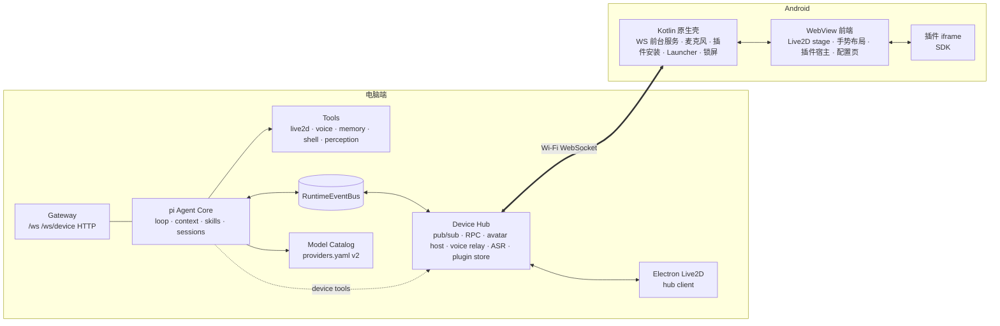
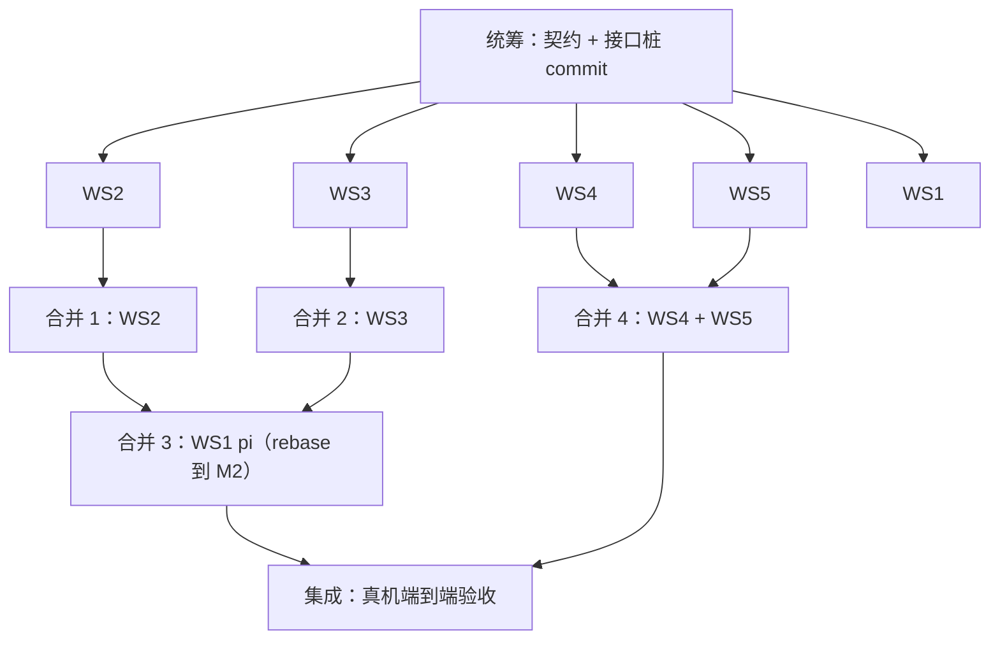

# Yachiyo Android Companion + pi Agent Core 总体施工计划

> 类型: plan
> 状态: active
> 负责人: codex-coordinator
> 更新: 2026-10-12
> 关联: PLAN-android-companion-contracts.md, EXP-20261012-android-live2d-webview-feasibility.md, 各 PLAN-android-ws*.md

## 1. 目标

1. 把 Live2D 桌宠移植到 Android（WebView 渲染，见实验文档结论）。
2. Agent 仍运行在电脑端；手机通过 Wi-Fi 与电脑端网关保持 WebSocket 长连接，在其上实现 **Device Hub 事件总线**（topic 发布/订阅 + 双向 RPC）。
3. Yachiyo 可以在电脑与手机之间**移交**：从一台设备屏幕下方离开，再从另一台设备下方出现。
4. 手机端：音频播放（TTS）、麦克风输入；竖屏全身 + 可自定义背景；横屏聚焦上半身，左滑露出插件入口，右滑露出桌面组件；动效丝滑。
5. 插件系统：JS + HTML5 小程序（横屏打开）与桌面组件，统一 `.yplug` 包格式，手机可直接导入，电脑端可推送；插件可访问事件总线并注册接口（可暴露为 agent 工具）。
6. 手机统一配置界面：服务端地址、背景、任务画布位置、插件导入、默认桌面接管、锁屏显示人物（锁屏下 agent 可控制人物、麦克风与音频，但不能访问插件）。
7. 模型配置升级：支持 DeepSeek 等多种 API、多模型选择、按用途分配、失败回退；电脑端配置页与手机端配置界面均可查看/切换。
8. **Agent 核心迁移到 pi**（`@earendil-works/pi-coding-agent`）：循环、上下文管理、技能、会话都由 pi 承担；现有工具、事件总线、设备 RPC、音频功能注册为 pi 工具；现有 prompt 迁移到 pi。

## 2. 架构总览

## 3. 工作流划分

| 工作流 | 执行者 | 分支 / worktree | 负责路径 | 施工文档 |
|---|---|---|---|---|
| WS1 Agent 核心迁移到 pi | Codex（gpt-6-astra，high，priority） | `agent/ws1-pi-core` | `apps/runtime/agent-pi/**`，`apps/gateway/server.js` 中 agent 装配段，`test/runtime/agent-pi/**`，`package.json` 依赖 | PLAN-android-ws1-pi-core.md |
| WS2 模型配置 v2 | Sonnet 5.5（medium） | `agent/ws2-llm-models` | `apps/runtime/config/**`，`apps/runtime/llm/**`，`apps/gateway/routes/modelConfig.js`，`apps/gateway/public/config-v2*`，`test/runtime/config/**` | PLAN-android-ws2-llm-models.md |
| WS3 Device Hub + 桌面移交 | Codex（gpt-6-astra，high，priority） | `agent/ws3-device-hub` | `apps/gateway/deviceHub/**`，`apps/desktop-live2d/**`，`apps/runtime/tooling/adapters/live2d.js`（路由），`scripts/plugin-*.js`，`test/gateway/deviceHub/**` | PLAN-android-ws3-device-hub.md |
| WS4 Android 原生壳 | Sonnet 5.5（medium） | `agent/ws4-android-native` | `apps/android/**`（`app/src/main/assets/web/` 与 `sample-plugins/` 除外） | PLAN-android-ws4-android-native.md |
| WS5 Android Web 前端 + 插件 SDK | Sonnet 5.5（medium） | `agent/ws5-android-web` | `apps/android/app/src/main/assets/web/**`，`apps/android/sample-plugins/**`，`scripts/android-sync-assets.js` | PLAN-android-ws5-web-ui.md |
| 统筹 | Claude（本会话） | `feature/android-companion` | 契约文档、合并、集成测试、真机验收 | 本文件 |

每个工作流在独立 git worktree 中开发（`../yachiyo-wt/<ws>`），只修改负责路径。共享文件（`apps/gateway/server.js`、`package.json`）的修改必须**局部、最小**（单独的装配函数 + 一两行挂载），以降低合并冲突。

## 4. 依赖与合并顺序

- 统筹者先提交接口桩：`apps/runtime/config/modelCatalog.js`（v1 兼容的最小实现）与 `apps/gateway/deviceHub/index.js`（空实现），使 WS1 可以在 WS2/WS3 完成前按契约编码。
- WS4 与 WS5 并行：WS5 用 `js/mockNative.js` 在桌面浏览器 / 真机浏览器中开发调试，合并后由统筹者联调。

## 5. 验收标准（统筹者执行）

| 编号 | 验收项 | 方式 |
|---|---|---|
| A1 | `npm run test:ci` 全部通过（基线 507 + 新增） | 自动 |
| A2 | `./gradlew :app:testDebugUnitTest :app:assembleDebug` 通过 | 自动 |
| A3 | 小米 6 安装 APK，竖屏全身显示，背景可自定义 | 真机 |
| A4 | 手机连接电脑网关；电脑端 agent 的 live2d 工具驱动手机上的人物 | 真机 |
| A5 | 移交动画：电脑 ↔ 手机往返各一次，非 host 端不显示人物、不发声 | 真机 + 桌面 |
| A6 | 手机播放 TTS 并口型同步；按住说话 → 识别 → agent 回复 | 真机 |
| A7 | 横屏聚焦上半身；左滑插件入口、右滑组件区，动画连续无跳变 | 真机 |
| A8 | 导入示例插件（app + widget）；插件经事件总线与电脑端通信并注册工具，agent 能调用 | 真机 |
| A9 | 电脑端推送插件到手机并自动安装 | 真机 |
| A10 | 设为默认桌面；锁屏显示人物，锁屏下 agent 可控制人物/语音，插件不可用 | 真机 |
| A11 | DeepSeek 等 provider 配置、多模型选择、回退生效；配置页可切换 | 自动 + 手工 |
| A12 | `AGENT_CORE=pi` 下全部原有 e2e 测试通过；`AGENT_CORE=legacy` 可回滚 | 自动 |
| A13 | 每个功能均有 `FEAT-*` 文档与 `TC-*` 用例，`docs/README.md` 索引更新 | 审查 |

## 6. 统筹待办

- [ ] **网关局域网加固**（WS3 合并后，统筹执行）：网关监听 `0.0.0.0`，`/api/config/*`、`/api/sessions*`、`/api/memory*` 等管理接口目前对局域网无鉴权，且既有 `GET /api/config/providers/config` 会返回内联 api_key。方案：非 loopback 请求必须携带 Device Hub `pairing_token`；`/api/config/providers/config` 与 `/raw` 对外脱敏。
- [ ] **WS3 合并审查必查**：设备 `pub` 不得发布网关保留主题（`plugin.install`、`avatar.host.changed`、`avatar.transfer.*`（除 ready/exited/entered）、`sys.device.online/offline`、`voice.play`、`chat.delta/final`、`task.update`）；`/api/device/*`、`/api/config/models*` 增加 CORS（源 `https://appassets.androidplatform.net`）。
- [ ] **工具名线上编码（阻塞多 provider）**：`config/tools.yaml` 工具名含 `.`（如 `live2d.motion.play`），OpenAI/Anthropic/DeepSeek 要求 `^[a-zA-Z0-9_-]{1,64}$`。在 `apps/runtime/agent-pi/toolBridge.js` 中把名称编码为线上名（`.`→`__`），执行时映射回原名；`piRuntime.js` 中 `toolName.startsWith('live2d.')` 等判断与 eventBridge 发出的 `tool_call.*` 事件需使用原名；补测试。
- [ ] WS1 遗留：`attachModelContext` 与 WS2 的 worker `model_ref` 透传重复，可删除。
- [x] 合并时统一重新生成 `package-lock.json`（WS1 合并时已 `npm i`）（WS1 新增 pi 依赖）。

## 7. 进度

| 工作流 | 状态 | 最新提交 | 备注 |
|---|---|---|---|
| 统筹：文档整理 + AGENT.md | done | 608edd7 | |
| 统筹：实验 + 契约 + 施工文档 + 接口桩 | done | 0c2b84b | |
| WS1 | merged | 7d4419a | 合并后 564 测试通过；待办：工具名线上编码 |
| WS2 | merged | 63504a1 | 统筹审查修复：/test 凭据外泄（63504a1）；538 测试通过 |
| WS3 | merged / integration | 84c2924 | 设备总线已合并，继续鉴权、发现广播和跨端联调 |
| WS4 | merged | c039c32 | 修复后合并：Bridge 令牌门控（391ab63）、插件推送仅信任网关且 token 不外发；Gradle 单测 + APK 构建通过 |
| WS5 | merged / integration | 0eaf75c | Web 前端已合并，继续自动发现配置与真机联调 |

## 8. Codex 接续验收（2026-10-12）

- 已保留旧 worktree 与未提交契约修改，新增三个独立 `agent/*` worktree；子 agent 统一 GPT-5.6 Sol / high，统筹负责合并验收。
- WS3 合并后 Node 588/588；WS5 合并后隔离测试环境 Node 624/624。首次 WS5 回归出现 legacy 子进程启动 7 秒超时，隔离后全量通过，继续观察。
- 集成 Android 已同步模型资源，JDK17 单测与 assembleDebug 通过。
- 用户新增目标 A14：配置页自动发现同一局域网的服务端、选择地址并配对；接口见 C7，广播不暴露令牌。
- 新分工：`ws1-pi-completion` 负责工具名兼容与 pi 补查；`ws3-integration` 负责网关通信边界、音频元数据与发现广播；`android-integration` 负责 Android 联调与发现 UI。
- 真机初验等待现有 WS5 设备锁释放，不抢占正在使用的设备。

### 集成批次 2

- 汇合 pi `74992fc`、Hub `2cb9de1/4e1c504/d553318/400969a/e976ec3`、Android `9fd91be/69d7e7e/e3e915e/4d99a7b`，同步依赖锁文件。
- 全量 Node 642/642 通过，Android 单测/assembleDebug 通过；新增完整 pi → Hub → 手机插件 RPC 离线 e2e 通过。
- 真机竖横屏、两侧面板、插件推送/安装和 start_timer RPC 已通过，详见集成实验与 TC-COMP。
- 新增用户目标 A15：小米 6 60 FPS。初始横屏仅20.34 FPS；耗时主要在 Cubism 求值，正在性能专项优化，不标记验收完成。
