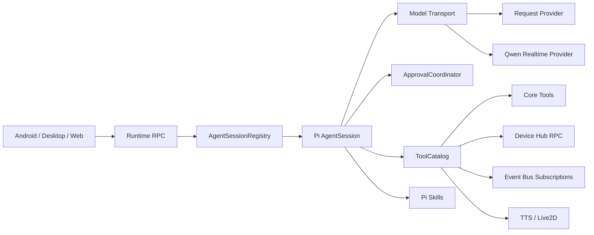

# Pi 长生命周期会话与统一工具平面施工计划

> 类型: plan
> 状态: done
> 负责人: Codex /root
> 更新: 2026-10-13
> 关联: docs/plans/PLAN-android-companion-contracts.md、apps/runtime/agent-pi/、apps/gateway/deviceHub/

## 目标

让 Pi `AgentSession` 成为普通模型与 Qwen3.8 Omni Realtime 的唯一 Agent 循环，恢复长生命周期会话、原生 steering/follow-up、并行工具和标准 Skills，同时把权限审批、设备 RPC、事件总线、TTS 与 Live2D 收敛到清晰的统一边界。

## 架构边界

- `AgentSessionRegistry`：拥有会话对象、模型切换、输入排队、idle eviction 与 settled 生命周期。
- `ToolCatalog`：把静态 ToolExecutor、动态 Device Hub 方法和会话级 bus 工具转换为 Pi tools；只为确有互斥要求的工具设置 sequential。
- `ApprovalCoordinator`：在 `beforeToolCall` 等待/自动批准/完全放行；UI 只能修改当前会话权限，模型没有提权工具。
- `RealtimePiTransport`：把 Qwen Realtime WebSocket 适配为 Pi model stream，并把原生音频作为 side channel 投递给 Avatar Host。
- `SessionEventSubscriptions`：每会话维护有界事件队列与可选 steering delivery；断开/回收时统一释放。

## 施工阶段

### P1 会话核心

- 新增长生命周期 registry，复用同一个 Pi AgentSession。
- 空闲 prompt、运行中 steer/followUp；以 agent_settled 收口。
- 会话模型选择持久化，并把 requested/resolved model 写入事件与消息。
- 保留 SessionManager JSONL，idle eviction 后可恢复。

### P2 工具与权限

- 恢复 Pi 标准 Skills、上下文文件和内置文件/shell 工具。
- 改造 tool bridge 为默认并行，并通过 hooks 接入策略层。
- 新增 `manual|auto_approve|full_access` 会话权限和 ApprovalCoordinator。
- 移除模型可见的 `shell.approve` 重试协议；Apple Music 保持 Skill。

### P3 Device Hub 与事件总线

- 注册 TTS、Live2D、avatar 和动态设备 RPC 工具。
- 完成 bus publish/subscribe/unsubscribe/pull/channels 工具。
- bounded queue、TTL、cursor、ACL 与 steer delivery。

### P4 Realtime

- 把当前 `omniAudio` 手写 function-call loop 移入 Pi model transport。
- 普通与 Realtime 共用 AgentSession、ToolCatalog、权限与会话历史。
- 原生音频/TTS 单通道互斥；保留 Qwen3.8 Omni 音频和 function call 兼容回退。

### P5 客户端与验收

- Android、Desktop 增加权限选择和待审批面板。
- 自动化覆盖会话复用、steer/followUp、并行工具、审批、bus、模型切换与 Realtime。
- 独立端口/独立 `YACHIYO_HOME` 启动 Gateway；获取设备锁后 Wi-Fi ADB 安装和回归。

## 提交与验证

每阶段独立提交代码、功能文档与 TC。Node 阶段运行 `npm run test:ci`；Android 阶段运行 `./gradlew :app:testDebugUnitTest :app:assembleDebug`。真机占用严格通过 `/Volumes/data/Users/Programming/yachiyo-wt/devlock.sh`。

## 进度

- [x] 2026-10-13：确定基线 `70212ff`，创建 `agent/pi-runtime-v2` 独立 worktree。
- [x] 2026-10-13：冻结 C5.1 架构边界和施工阶段。
- [x] P1 长生命周期 AgentSession（registry、模型归因与持久历史已完成；steering/follow-up 与 TurnCoordinator 已启用）。
- [x] P2 工具与权限（副作用感知并行、ApprovalCoordinator、标准 Skills/context 及受控 read/bash/edit/write 已完成；外部 extensions/MCP 保持禁用以守住策略边界）。
- [x] P3 Device Hub 与事件总线（动态 RPC、Avatar、会话级 publish/subscribe/unsubscribe/pull/channels 与 high-priority steering 已接入）。
- [x] P4 Qwen Realtime Pi transport（原始音频直接挂入 Pi user turn；`qwen-realtime` adapter 转换 input_audio/transcript/toolCall，并以 side channel 发布原生输出 PCM；无独立 Realtime ASR 循环）。
- [x] P5 双端 UI、自动化与真机验收（Android 与 Desktop 均可修改当前会话策略并处理待审批；Node 848/848、Android 单测/Debug APK、Wi-Fi ADB 小米 6 三档策略实机回读通过）。

## 交付记录

- 会话核心与工具平面：`26f81a2`、`fe51461`、`5259ff7`、`96fb0be`、`8ad1a0f`、`4dd3340`。
- Realtime Pi transport 与音频直通：`0e39882`、`e1ccfd7`。
- Device Hub 会话控制与双端 UI：`941253f`、`3f02429`、`f96e4c5`。
- 自动化与真机证据：`docs/experiments/EXP-20261013-pi-session-v2-acceptance.md`。
- 2026-10-13 真机回归修复：长生命周期会话第二轮曾重放全部历史 PCM，导致 Realtime 上游在 `response.done` 前断开。现在只发送最新未消费音频；历史语音按文本回放，工具续轮不重复上传 PCM，关闭错误同时记录 WebSocket code/reason。云连接仍按 Pi provider 请求重建，后续可继续优化为单 turn 连接复用以降低延迟。
